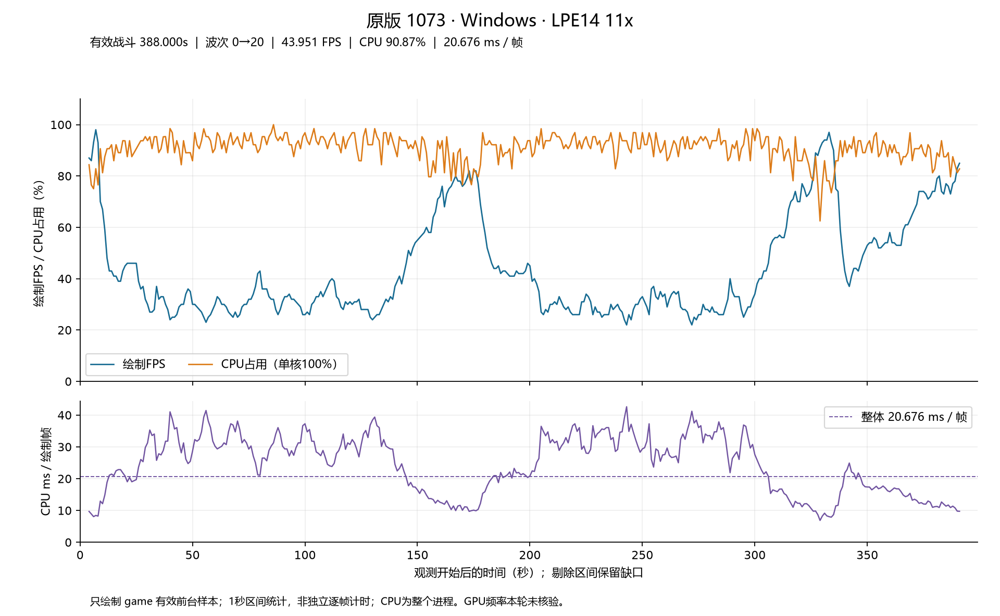

# 性能优化原理与基准

本页按优化原理组织；每节先解释减少了什么工作，再列对应基准与测量边界。当前版与1.0未见明确提升的同口径指标只列当前值；改善明确且口径一致时保留1.0比较。细小波动不登记为新收益。完整历史原始记录继续归档，已退役路径不留在现行性能表中。仍生效的机制先例单独保留；没有新同口径测量时明确标注历史，不因删除旧夹具而删除优化原理。局部表缺少static属于本项目代码缺陷，修复记录见[修复总账](fix-ledger.md)，不列为原版路径的优化收益。

本页已归档数值以2026-11-01的v3.2.4测量构建为准；当前发行版不自动继承为“已复测”。保留仍有比较意义的1.0同口径数据；已退役机制只解释原理与历史边界，不重新包装成当前收益。

各表以所链接的构建哈希与测量条件为准；程序版本与存档格式版本分开记录，当前存档格式为v5.1。

“原机制模型”“原版代码片段编译”“原版EXE机器码”“当前生产函数”分开标明。不同范围不互相替代，ns/查询、整轮总耗时、CPU Draw和整局成本分别解读。

## 1. 将多段条件选择变成静态参数表

固定枚举到参数的映射可在编译期建表。一次范围检查和下标读取替代多段条件比较；常量数据集中存放，也减少重复业务代码。函数指针表适用于需要不同处理函数的情况，但间接调用本身有成本，不能据此推断所有switch或if-else都应替换。

### 实际原版EXE与当前生产函数

五项查询对同一输入逐项对拍。原版x86机器码在隔离进程以SEC_IMAGE映射到首选地址，绑定受控对象；当前侧链接实际x64 Release /GL /LTCG对象。串行原版—当前—当前—原版，各进程min-of-5，单位ns/查询。

| 查询 | 原版EXE，进程1／2 | v3.2.4生产函数，进程1／2 |
| --- | ---: | ---: |
| 伤害范围 | 35.034／34.469 | 6.931／6.942 |
| 花盆高度 | 45.067／46.903 | 8.263／8.265 |
| 种子特殊价格，56..74 | 51.608／51.683 | 6.431／6.431 |
| 商店29项有效商品 | 48.766／49.008 | 10.570／10.605 |
| 大头贴调色范围 | 41.489／41.809 | 8.725／8.725 |

输出向量一致，花盆高度核对float位模式。输入包装和checksum计入时间；x86/x64、编译器、ABI、LTO不同，不能把全部差值归于查表。此处种子尾段不是下表的75项成本夹具，商店29项也不是旧31槽输入。[本轮原始结果](../Tests/evidence/v324-microbenchmarks-20261101/production/summary.json)、[原版ABI](../Tests/evidence/production-small-benchmarks-20261029/retail-abi.json)。

### 同口径参数选择模型

从当前源码提取实际表声明，放入原夹具；保留原输入和下游桩。MSVC14.51 x64 /O2 /GL-，每进程min-of-5，单位ns/次。它衡量参数选择及共同桩，不是完整Draw/Update。

| 参数表 | 原链模型重测，进程1／2 | v3.2.4进程1／2 |
| --- | ---: | ---: |
| kDamageRangeFlags | 32.89／33.17 | 6.89／6.90 |
| kFireProjectiles | 44.04／44.16 | 7.12／7.12 |
| kFlowerPotAdjust | 34.13／34.13 | 8.96／8.97 |
| kSeedPacketDrawMetrics | 62.12／62.24 | 26.73／26.75 |
| kZombieImageOffsetFix | 33.01／33.01 | 9.45／9.42 |
| kWalkHeadPos | 30.57／30.62 | 14.65／14.61 |
| kSeedTypeUpdates | 55.43／55.42 | 47.03／47.07 |
| kShadowParams | 89.59／89.52 | 59.66／59.78 |
| kSeedCostOverrides | 39.15／39.30 | 32.48／32.34 |
| kStoreItemCosts | 40.11／40.13 | 10.72／10.73 |
| kPlantHeightOffsets | 26.98／27.08 | 11.75／11.74 |
| kPlantShadow | 40.40／40.47 | 22.83／22.85 |
| kZombatarPaletteRange | 26.64／26.69 | 8.67／8.67 |

这些机制与1.0同口径指标没有明确的新提升时，只列当前值，不重复1.0列。kSeedTypeUpdates夹具已适配显式owner／visual／animation三时钟参数；共同Mix桩忽略时间，不代表完整植物更新。商店模型仍均匀输入31槽，其10.72ns级结果不等于29项有效购买业务的完整成本；原版模型、当前表声明与实际函数不混用。本轮13项均通过checksum，全部两进程结果保留。[当前表声明和原始输出](../Tests/evidence/v324-microbenchmarks-20261101/table-models/manifest.json)。

## 2. 缩小候选集合，减少全池与全轨道扫描

僵尸行索引、植物每格分层桶直接给出候选对象，原池仍为真值；轨道活动位与分组占用掩码跳过没有工作的槽。关键是维持顺序、first-match、重复同名轨道和附件兜底，避免用改变语义的“更快遍历”替代原功能。

### 对象查询

单位ns/查询，两个独立进程min-of-5。原版侧为实际EXE对象池查询；当前侧使用真实对象布局。本轮使用当前布局：Zombie608、Reanimation296、Plant568、轨道实例128、TodParticle184字节。粒子归一化年龄缓存放在16KiB侧表，不增加实例字段。

| 负载 | 原版EXE全池 | v3.2.4实际全池 | v3.2.4索引路径 |
| --- | ---: | ---: | ---: |
| 1024僵尸，本行171 | 8344.799／8387.979 | 6482.390／6482.270 | 3969.408／3967.309 |
| 48植物，54格 | 548.063／548.244 | 282.173／282.878 | 55.439／55.435 |

植物按同一MT19937序列放置并执行两百万查询，四层结果归一化后校验和一致，格桶额外核对54格。僵尸结果均171个。旧168字节僵尸模型与当前布局不同，不拿旧模型结果计算当前提升。

### 轨道筛选

250实例×30轨道，单位µs/pass；读取当前真实类型，下游为两侧相同的可观察桩。不是完整Reanimation::Update或Draw。

| 负载 | v3.2.4全扫 | v3.2.4掩码 |
| --- | ---: | ---: |
| 0%活动，每实例2条attacher | 51.879／49.439 | 6.498／6.500 |
| 5%活动，每实例2条attacher | 44.937／45.228 | 9.943／9.914 |
| 绘制组，18组／实际占用组 | 203.768／210.871 | 58.856／59.161 |

命中数、下游调用数及原版／当前对象查询checksum一致。本轮植物全池约282ns，前次约259ns，出现退步；格桶约55ns仍接近前次，僵尸行查询约3969ns也与前次约3966ns接近。轨道筛选与分组扫描有混合变化，不由其中一个内核推断完整Update变快。全部两进程原始数据和当前对象尺寸见[本轮生产基准](../Tests/evidence/v324-microbenchmarks-20261101/production/summary.json)。

### 连续粒子名册与附件平面遍历

发射器／粒子遍历使用紧凑槽号名册，替代TodList指针链，减少节点到ID再到对象池的依赖读取；尾存倒序维持原AddHead顺序。更新循环已知槽号时直接传给DeleteParticleAt，避免每次删除重新Find；交叉源级联等下标未知路径仍查找，不能删除必要的兜底。实现见TodParticle.cpp的ParticleRoster和DeleteParticleAt。这是仍在生效的遍历与删除优化，不因结构基准更换就退役。

附件保留固定效果数组，以平面for遍历和可达效果分支取代旧显式DFS栈及不可达嵌套附件处理。实现为Attachment.cpp的UpdateAt、SetPosition、SetMatrix、Draw等；本轮时间域传递变化不等于恢复嵌套遍历。

历史粒子名册模型记录132.2→2.42µs/pass（900粒），已知槽删除模型801.5→550.3ns；它们是旧布局的历史模型，不能冒充当前184字节粒子完整更新。附件历史模型含particle/trail/reanim/other且下游为空桩，trail已退役，因此不恢复为现行混合负载指标。机制保留，旧数据与条件可追溯到[v2.0总账](https://github.com/YuHao2006/pvz_perf/blob/v2.0/docs/perf-fix-ledger.md)及[56项覆盖清单](../Tests/evidence/production-small-benchmarks-20261029/coverage.json)，不将历史模型复跑当成当前生产性能。

## 3. 把字符串身份与重复解析移到编译期

粒子具名查询用枚举，前缀查询用编译期区间，定义首见用直索引；reanim动作、轨道ID和MPHF也在编译期生成。运行期避免重复strlen、字符串比较和全定义扫描。外观变体复用根行为，加载期赋图集指针，不再逐实例复制行为或逐轨覆写图片。

### reanim 名字枚举、MPHF 与 attacher 段表

测量状态：下表为历史先例，本轮未重测完全相同口径的字符串查名／attacher基准；不与当前帧相位基准混用。

**名字枚举首先在 reanim 落地。** 原逐 tick 轨道名字扫描、attacher 文本解析改为 `ReanimTrackId`、联合键 MPHF 和编译期整数段表；粒子随后采用枚举与区间。IDT5 装载清理是后续变化，不能覆盖或替代这一收益。

| 原机制 → 已落地机制 | 对拍或容量变化 | 范围与证据 |
| --- | --- | --- |
| `strnicmp` 线性轨道扫描 → `(type,id)` MPHF 直达、零字符串零回退 | 原始记录 65–262ns/查 → 全路径 2.92–4.13ns/查 | **历史未复测**：原轮锁定与逐路径配对未重新核实，保留原始收益记录，不据区间端点算新倍率。credits 约 3400 万次/轮是旧负载；Git `74279f21`、`aeb80da3`、`91f40433`，历史测量汇总 `ac6fe907` |
| 每类型 MPHF → 全局共享单表 | 约 154KB → 44KB，减少约 110KB（71%） | 表容量估算，非进程驻留内存；Git `487a3a0d`、`5739a3cd` |
| 每 tick 文本解析、每实例动作缓存 → 编译期整数段、资源共享缓存 | 缓存约 19KB/实例 → 2.4KB/资源；锁定轮新实现 `UpdateAttacherTrack` 379ns | 容量的共享粒度改变；379ns 仅是满员 credits 新路径成本，没有同场景旧值，不登记耗时倍率。Git `de7172f6`、`4d0602ad`、`b0d78ac9` |

名字接口与查找见 `pvzPerf/Sexy.TodLib/Reanimator.cpp`、`ReanimTrackId.h`、`ReanimTrackMphfGlobal.h`。attacher 隐藏值按原始帧语义处理，重复 ID 轨道也须保留；名字消除不等于合并同名轨道。旧未锁绝对成本不能与 379ns 相减。

历史内容可在[v2.0总账](https://github.com/YuHao2006/pvz_perf/blob/v2.0/docs/perf-fix-ledger.md)核对；这里保留仍生效机制及原始边界，不把历史数值改标为3.0新测。

### 当前reanim整数身份查找

新增同生态位对照：对所有定义的2641条合法轨道查询穷举验证，重复ID取首条；两个进程各六个计时轮，AB／BA交替，min-of-6，单位ns/查询。共同包装与checksum计入时间。

| 当前同一语料 | 进程1／2 |
| --- | ---: |
| 整数ID线性扫描模型 | 51.979／51.984 |
| 实际FindTrackIndex／MPHF接口 | 15.529／15.470 |

这隔离的是整数身份查找结构，不是原版字符串函数；不能与上面的历史字符串区间拼接算倍率。[原始两进程与2641项校验](../Tests/evidence/v324-microbenchmarks-20261101/reanim_identity_benchmark/)。

### 粒子身份查询

旧112系统／222定义固定语料，MSVC C++23 /O2 /Ob2 /GL- /fp:precise /OPT:NOICF；两个进程，每侧九轮AB/BA的中位数，单位ns/查询。保留共同选择和颜色写入，不含分配、交叉淡化执行、渲染和建表。

| 负载键 | 字符串／扫描模型（进程1） | v3.2.4 ID／区间（进程1） | v3.2.4 ID／区间（进程2） |
| --- | ---: | ---: | ---: |
| unnamed_tiny_1_10 | 32.131756 | 18.281276 | 18.275684 |
| unnamed_fast_tiny_1_10 | 24.351440 | 18.272777 | 18.249712 |
| all_tiny_1_10 | 24.294101 | 23.656534 | 23.651055 |
| named_exact_tiny_1_10 | 66.542617 | 19.493512 | 19.347672 |
| family_prefix_tiny_1_10 | 90.988577 | 18.314123 | 18.496388 |
| unnamed_full_corpus | 35.433908 | 18.730664 | 18.712253 |
| unnamed_fast_full_corpus | 25.200428 | 18.694661 | 18.699777 |
| all_full_corpus | 24.971537 | 24.582343 | 24.540852 |
| named_exact_full_corpus | 113.276383 | 22.818240 | 22.760755 |
| family_prefix_full_corpus | 120.156783 | 20.723677 | 20.752299 |
| family_prefix_cached_tiny_1_10 | 50.059753 | 18.291852 | 18.321062 |
| family_gloom__own_system | 334.196507 | 45.818551 | 45.829959 |
| family_icetrap_own_system | 90.363729 | 25.515601 | 25.524739 |
| family_awardray_own_system | 568.657028 | 56.361079 | 56.128475 |
| family_doommushroom_own_system | 506.647525 | 47.194013 | 47.199896 |
| find_scan_tiny_1_10 | 44.209197 | 9.210618 | 9.227348 |
| find_direct_tiny_1_10 | 43.916100 | 5.997126 | 6.212912 |
| find_scan_full_corpus | 69.382739 | 11.072745 | 11.116207 |
| find_direct_full_corpus | 68.755299 | 6.373619 | 6.520637 |
| find_fadeout_present_systems | 48.657175 | 5.815830 | 5.954667 |
| find_fadeout_full_corpus | 29.731896 | 5.528908 | 5.964354 |

与1.0最终机制相比没有明确新提升，故只列当前数据。语料未覆盖新增变体，不扩称所有现行粒子定义。[完整固定语料与两进程原始样本](../Tests/evidence/v324-microbenchmarks-20261101/table-models/13_bench_particle_emitter_names/)。

NRSC4直接向具名图片／字体／声音变量赋值，运行期ResourceId与ImageSymbolId已退役，旧身份只在离线转换使用。加载后释放CPU解码图片。这里解释减少的工作，没有另测启动时间，不虚构启动提速。

## 4. 合并GPU调用，减少动态数据与重复采样

bindless只减少纹理描述符切换，不会自动合并不同混合状态。Vulkan保留相邻同态绘制顺序，合并可兼容的提交，不按纹理重排半透明图元。

| 优化 | 已落地做法 | 作用范围与限制 |
| --- | --- | --- |
| 普通／additive合批 | 支持dualSrcBlend时统一双源精灵混合；不支持时使用独立管线 | 减少交替混合造成的断批，不减少特效或改变叠加顺序 |
| 透明边缘处理 | 普通图像上传前修补全透明像素RGB | 把原逐fragment邻域采样移出稳定绘制路径，保持alpha与线性采样语义 |
| 专用精灵shader | 直通输入走精简采样，生成图像／滤镜／覆盖率走对应路径 | 避免把字形或特殊输入错误套进普通路径 |
| 四顶点矩形 | 调用点直接提供四角，配静态16位索引 | 每矩形动态顶点从6×40字节降到4×40字节；不在提交期比较顶点去重 |
| 混合索引前缀与固定容量 | 纯三角形／矩形用静态索引，混合时才物化索引前缀；普通图片直接写最终四角顶点 | Vulkan每帧固定65536顶点，无分页或扩容；超过容量报错，包含最终呈现几何 |
| 状态复用 | 合批并复用未改变的管线、纹理和裁剪状态 | 不取消有业务语义的局部裁剪 |
| Vulkan 双槽帧资源 | 仅命令／同步对象与动态几何流轮换；复用前非阻塞检查fence，未完成跳过绘制、逻辑照常；所有纹理和渲染目标共用 | 桌面像素／生命周期／同步回归通过，手机整局收益未测；不据此宣称提升 |
| Vulkan 1.3 同步 | 图像／回读屏障改用 Synchronization2，帧、上传和图像批次使用 Submit2；呈现释放的目标阶段为 NONE | 场景回到颜色附件时按已知读写用途同步，不再一律 ALL_COMMANDS；尚无单项提速测量，既有整局数据不代表此改动 |
| 离线图集与上传 | 离线装箱、共享图集、上传后释放CPU解码数据，空上传队列立即返回 | 不把图集面积当作实测显存，不把60秒可行排布称为已证明最优 |
| 泳池 | CPU按行／列复用波纹求值，GPU绘制网格并生成焦散纹理 | 保持v3.2.3分工，与已撤销的reanim／particle GPU求值分开判断 |

同一个7687三角形的固定GPU夹具中，draw／管线绑定计数从1989到185，再到34；提交顺序和内容保持。它是调用结构证据，不是锁频提速倍率。[GPU专项](gpu-submission.md)说明实现、像素门槛及原始证据。

### 复用资源，缩小派生缓存

同一地图不再重复放入 Credits 图集。DSL 的 `shared-image` 在加载期绑定已有地图纹理；共享纹理统一放入全局表并按资源去重，表里不保存任何 reanim 专用图集。当前只有5个外部纹理指针；4个 Credits 定义用8个紧排的整数索引引用它们，普通图像槽不占这些表。编译器把外部槽排在各定义末尾，同时重排关键帧槽号与UV；普通定义的数据顺序不变。每个定义仍保留专用图集，普通 reanim 在渲染组入口读取一次外观纹理，轨道循环不查询外部表。x64静态定义为88字节，范围元数据利用对齐空隙；全局指针与索引合计72字节，不增加实例或存档字段。共享绑定、完整资源重载和14张Credits截图逐像素对拍均通过，见[全局外部纹理证据](../Tests/evidence/reanim-global-external-textures-20261114/README.txt)。

图鉴把三页完全相同的像素保存一份，差异作为补片，地面复用地图与冰道；大头贴静态界面离线烘焙并裁去透明边缘。逻辑尺寸和点击位置仍独立保留。普通卡牌用底板和植物预览；战斗／传送带在选卡结束后建立临时卡牌图集，退出关卡或生存换轮销毁。升级植物价格变化只覆盖对应卡片区域，不在每帧重建图集。

同口径全资源组显存夹具的一次候选运行中，空阵型无尽阶段的采样纹理需求由173.532降至169.712 MiB，池内实际使用由206.643降至203.354 MiB；64 MiB分块预留仍为256 MiB，不能声称驱动已分配显存同步下降。该夹具不是重负载无尽实战，不产生FPS收益结论；演员预览缓存仍保留。原始记录与像素证明见[资源候选证据](../Tests/evidence/vulkan-memory-candidate-20261114/README.txt)。

reanim插值、三角函数与particle模拟及绘制参数均在CPU；GPU只消费最终几何。颜色压缩、矩形实例、生成图像合批等未进入当前路径的试验不计入已落地收益；双槽主帧资源已落地。

DX12已接入普通精灵专用shader、normal／additive双源合批、四顶点矩形、静态16位索引与混合索引前缀，并复用提交暂存数组及未变的根常量。共享加载路径中的透明边缘修补同样生效。当前DX12场景目标仍为BGRA8：源RGB乘alpha前移到shader后会改变UNORM取整位置，四层叠加对拍容许累计4个字节级色阶差异；覆盖率字形仍保持精确比较。独立RTX 4070渲染检查包括80000顶点跨界拆批和混合图元，不能把检查通过写成已测提速倍率。[DX12验证证据](../Tests/evidence/dx12-gpu-submission-20261029/)。

OpenGL已接入下文的普通贴图硬件采样及状态缓存专项，功能验证见[OpenGL证据](../Tests/evidence/opengl-sprite-v3-20261029/)。帧资源轮换现已扩展到GL／WebGL、DX12及DX9：每个槽位的动态数据由其完成信号保护，主画面只轮询状态，忙时延期绘制而不阻塞逻辑；纹理仍共用。GL不再每帧glFinish，DX12的可写描述符也按槽位隔离，只同步变化的纹理描述符。资源上传、读回、销毁和尺寸变化所必需的同步仍保留。

Metal源码同样按双槽位组织，复用顶点和argument buffer，并使用四顶点矩形与静态16位索引；当前没有Apple编译环境或实机，不能视为已通过验证或已测提速。Web通过requestAnimationFrame让出执行权，避免绘制提交计数高于浏览器重绘节奏；绘制FPS仍不等同于屏幕实际呈现FPS。各后端验证边界见[本版说明](releases/v3.3.2.md)。历史DX12与当前Vulkan不用于量化单项GPU优化收益。

### 同口径固定DrawScreen：保留1.0对照

固定800×600、32株植物／40僵尸，DX12 Release/LTO、LP14、用户控制11x；预热128次，每进程640次采样。计时仅WidgetManager::DrawScreen，不含setup、flush、fence或readback。

| 指标 | 1.0 | v3.2.4进程1 | v3.2.4进程2 |
| --- | ---: | ---: | ---: |
| CPU Draw中位数 | 2303.925µs | 1253.300µs | 1264.600µs |
| CPU Draw p90 | 2453.100µs | 1312.100µs | 1329.900µs |
| 线程周期中位数 | 7065293.25 | 3867034.0 | 3900672.0 |

同一计时范围相对1.0的中位数观测下降约45.6%～45.1%。这是整套引擎与绘制改动的共同结果，不能单独归因某项GPU优化。本轮两进程画面稳定，像素SHA256与归档3.0相同；1.0旧画面二进制没有归档，不声称与1.0逐像素零差异。[固定场景原始结果](../Tests/evidence/v324-microbenchmarks-20261101/frozen-draw-summary.json)。

### reanim／particle：GPU化不可行，保留CPU求值

**本项目当前不采用reanim／particle的GPU化方案，按现有负载与实现判定为不可行。** 这里指把动画求值或粒子模拟搬到GPU；纹理采样、混合和三角形绘制仍由GPU负责，不是退回软件渲染。结论限定于本项目当前方案与已验证设备，不推断所有GPU架构或未来实现都不可能获益。

| 模块／方案 | 不采用的原因 | 当前运行路径 |
| --- | --- | --- |
| reanim在顶点shader内插值和计算三角函数 | 同一轨道的四个角点会重复求值；减少CPU工作未形成明确的整机功耗收益，不能把GPU busy或CPU占用单独当作能耗结论 | CPU定位整数相位、插值，并为每条轨道计算一次变换；四角复用，随后提交GPU绘制 |
| reanim每轨道先用compute生成变换基向量 | 虽消除了重复三角函数，但增加dispatch、GPU内存屏障及中间缓冲写入／读取；包含预计算与绘制的桌面GPU总计时未通过收益门槛 | 撤销预计算管线及中间资源，不在游戏中保留运行时切换或回退分支 |
| particle公式路径或完整GPU模拟 | 现行离散力场、随机参数、生命周期与交叉淡出依赖CPU状态；拆成多套路径会增加状态同步、排序及维护成本，当前不重新启用 | CPU按实际纳秒步长模拟并求绘制参数，GPU只接收已确定的几何与绘制状态；公式粒子保持退役 |

本轮重新测量的是reanim方案，没有取得新的particle GPU模拟对照数据；particle部分是当前工程取舍及已有路径撤销结论，不虚构新的粒子性能数字。相邻绘制合批、静态索引与透明边缘处理继续生效，GPU化撤销不等于撤销这些优化。

CPU侧使用FastSinCos，让同一角度的sin／cos共享一次角度归一化，再求两项多项式；reanim的两个skew轴各求一次，矩阵由四角复用。该改动不改变整数纳秒相位或存档布局，不据局部三角函数基准宣称整帧提速。

同输入、真实FastMath翻译单元、LP14／11x、每轮两百万次、九轮中位数，单位ns/两轴变换片段：

| 两轴片段 | 进程1／2 |
| --- | ---: |
| 原四次FastSin／FastCos | 62.047／62.019 |
| 共享范围归一化FastSinCos | 53.332／53.305 |

[原始样本](../Tests/evidence/v324-microbenchmarks-20261101/trig/)同时保留CRT、sqrt和pow诊断；后几项不是现行优化候选，不纳入收益表。

发射器系统渲染参数缓存未采用。它对同发射器的多粒子负载有局部收益，但单粒子负载会增加成本，实际效果还取决于改版的轨道和生命周期设计。为保持通用路径精简，已撤销缓存侧表、失效处理及专属测试，系统参数继续逐粒子求值；不在现行优化指标中登记该试验收益，存档格式未改变。

这轮试验原始样本已清理，只保留v3.2.3基线数据供后续同口径复测；本节保留方案结论，不登记GPU化收益。文档内已有的1.0／3.0正式历史基准不属于这轮试验数据清理范围。

## 5. 整数时间与相位求值：用CPU成本换一致性

共享纳秒时钟与出生／结束时间避免浮点时间逐拍漂移。reanim以整数时间定位相位，根运动用完整周期位移加当前周期插值，位置不从上一拍坐标累加。普通物件和粒子仍按实际纳秒步长模拟，复杂力场不强行公式化；公式粒子和运动指数采样表已退役。

目标FPS控制调度节拍，不等于把每次更新伪装成固定时长。单次逻辑更新消费实际积累的纳秒时间，不截成10ms，也不拆补拍；节拍余量用于安排下次更新，避免同一段时间被模拟两次。逾期不额外sleep，离散碰撞／力场精度允许随步长变化；reanim相位和根运动仍按共享时间求值，规则见[运行时](runtime.md)。

### 常值轨道短路

FloatTrackEvaluate在单节点且low==high时直接返回常量，跳过曲线选择、随机区间及插值工作；空轨道也保留直接返回。这个短路仍在Definition.cpp使用，与时间比例从哪里取得无关，不能因为删除旧代数夹具就省略其原理。旧3.90→2.75ns记录的锁定条件未确认，不作为3.0有效数值；寿命倒数乘则已被出生时间和侧表机制取代，不恢复成当前方案。

### 复用单次更新时间求值

粒子数据池以两张1024项double侧表缓存粒子与发射器的归一化年龄比例，不增加实例字段，由当前纳秒时间减出生时间求值后共享给物理轨道与绘制。初始化、循环、交叉淡出寿命变更及读档重建缓存；字段不序列化，没有浮点时间累加。附件轨道先求一次GetFrameTime，再将同一结果传给变换求值，避免重复采样和除法。

缓存的受控实测不支持“每种场景都更快”。当前真实完整渲染参数查询与冻结未缓存函数体对拍，不是原版EXE；每组min-of-5、单位ns/查询：

| 负载 | 未缓存，进程1／2 | 生产侧表，进程1／2 |
| --- | ---: | ---: |
| 有轨道，只查询一次 | 204.055／203.809 | 198.075／198.005 |
| 有轨道，刷新＋一次消费 | 204.167／204.032 | 207.911／208.235 |
| 有轨道，刷新＋四次消费 | 204.110／204.196 | 200.726／201.073 |
| 默认快路，刷新＋一次消费 | 84.541／84.462 | 94.273／94.025 |

物理更新本来已有年龄求值。默认快路通常没有读取收益，计入刷新后可能更慢；多消费者才有复用空间。夹具不代表完整粒子更新或整局成本。[全部两进程与逐粒子对拍](../Tests/evidence/v324-microbenchmarks-20261101/particle_life_side_cache_benchmark/)。

普通波次进度条仅在50ms／200ms边界改变宽度，因此先递减旗帜动画倒计时，再在无边界时直接返回，跳过波次血量扫描及几何／血量比例计算；最终Boss每次更新的进度路径保持原有规则。主循环中仅demo快进使用的pendingAdvanceNs换算也移入对应分支。这些改动尚未单独量化，不将减少操作数直接换算为整局FPS收益。

### 共享关键帧缓存：绘制、根运动和保龄球

Reanimation统一保存当前关键帧号、该关键帧的整数纳秒起点及整数帧时长。更新以整数除法／取模求跨帧数与余量，推进帧号／起点，保留本次更新越界的整数时间。同一更新时间的后续查询直接复用归一化快照。帧时长的小数纳秒固定舍弃，周期为整数帧时长乘区间数，各步长使用同一时间轴。不缓存帧时长倒数，插值处临时计算double(age)/double(framePeriod)。动画速率仍为float输入，不累加浮点相位。

GetFrameTime、RootMotion及坚果保龄球共用实例帧状态，避免反复以完整相位乘区间数再做整数除法。Reanimation在回绕时直接累加根运动基础位移，不记录累计周期；Zombie只保留世界坐标绑定偏移，不保存已消费周期或缩放乘积缓存。固定_ground直接定位。事件仅记录本次更新的回绕量，lastUpdate用于暂停与重绑；原版业务完成计数mLoopCount保留。旧mPhaseOriginNs删除。

正向跨帧直接定位，不使用while逐帧减法；倒放与回溯定位放到独立函数。倒放的帧内读取也使用缓存，原版潜水僵尸以-24播放anim_uptoeat的行为保留。冷路径不是取消功能或逐tick子模拟。

#### 除模推进与多处查询实测

当前实现保持关键帧起点的原有含义，不增加字段或改变存档。Windows MSVC Release/LTO、LP14，速率30，30Hz实验步长；每格十轮、每轮一百万次更新。独立消费者通过不可合并的调用分别查询帧时间和根位移，表内为更新加全部查询的ns中位数。

| 每次更新后的查询次数 | 当前除模＋帧缓存 | 周期锚点＋帧缓存原型 | 周期锚点无帧缓存原型 |
| --- | ---: | ---: | ---: |
| 1 | 80.34 | 75.64 | 72.98 |
| 2 | 122.82 | 124.14 | 136.79 |
| 4 | 196.21 | 209.80 | 234.23 |
| 8 | 342.72 | 381.07 | 422.99 |

缓存维护有成本，单次消费可能更慢，多次独立消费能复用结果。后两列使用同一周期锚点策略，更适合隔离缓存成本；当前实现还保留原存档锚点语义与完整边界行为。此夹具不含矩阵或GPU提交，频率未锁定，不换算整局FPS；实验步长不代表修改了运行时帧率限制。[原始数据与验证](../Tests/evidence/reanim-multi-query-20261030/README.md)。

手写余数为a-q*b未获收益：独立商／余数消费下，120Hz数据集的相邻/与%约5.52ns/输入，手写式约11.01ns。该MSVC上下文为手写式生成了两次同输入DIV；相邻/与%共享一次DIV的商和余数。这是编译器与上下文的结果，不能推广为乘减天然更慢。[源码与机器码证据](../Tests/evidence/reanim-divmod-remainder-20261030/README.md)。

#### 当前共享帧API：查询与推进分开计时

Windows Vulkan Release/LTO、LP14、用户控制11x。四种真实行走定义，两个进程串行，第二进程逆序；各内核min-of-5，单位ns/操作。查询准备在计时外，推进组包含真实Advance；不是完整Zombie::Update，也不含GPU提交。

| 定义 | Root查询 | FrameTime查询 | 推进＋Root | 推进＋FrameTime | 推进＋ZombieRoot |
| --- | ---: | ---: | ---: | ---: | ---: |
| 普通 | 41.233／41.264 | 29.814／29.860 | 87.487／87.698 | 74.174／74.072 | 91.401／91.597 |
| 橄榄 | 41.208／41.216 | 29.815／29.828 | 88.137／88.348 | 74.969／74.868 | 92.494／92.507 |
| 报纸 | 41.183／41.217 | 29.806／29.803 | 87.522／87.298 | 74.208／74.187 | 91.229／91.728 |
| 撑杆 | 41.204／41.255 | 29.831／29.815 | 87.546／87.399 | 74.173／74.259 | 91.589／91.359 |

完整推进、不同步长和独立多处消费者数据分别保存在[当前帧缓存基准](../Tests/evidence/v324-microbenchmarks-20261101/reanim_frame_cache_benchmark/)。各定义有独立帧号、比例、根位移和世界坐标对拍。frozen_v36内核只是冻结的旧精确相位算术模型，边界与完整API不同，不冒充原版EXE或用来计算原版提速。原3.0数据保留在历史证据中，不继续充当当前成绩。

伴舞普通相位为200ms×23帧，入场为100ms×11帧，继续使用原app时钟语义。真实UnsignedTimeCounter的多步长与旧32位回绕测试通过；不把它擅自换成会随Board暂停的关卡时钟。

### OpenGL 普通贴图专用采样路径

OpenGL 3.0 普通主场景贴图使用独立 GLSL 1.30 shader，纹理单元完成最近邻／双线性和 clamp／repeat；替代通用片元 shader 的四次 texelFetch、逐点寻址与手工插值。按程序及采样方式分批，纹理缓存实际 filter/wrap 状态，仅在变化时设置。无需 OpenGL 3.3 sampler objects，不改变绘制顺序或存档。

文字覆盖、生成纹理、离屏预乘目标、HSL 及显式边缘过滤仍走专用或通用路径。硬件线性权重精度可能与全浮点手工插值相差少量色阶，不承诺逐位相同；不压缩任意 float 顶点颜色。此项不属于前述已完成微基准或Vulkan整局测量，GPU收益尚未量化。

## 6. 整局结果：验证以上机制的共同效果

整局观测不能拆成各项优化收益之和，也不能由CPU时间推导GPU耗时或手机功耗。v3.2.4现行微基准与同运行路径的Windows Vulkan整局均已完成；整局使用空闲恢复与缩放资源修复之后的Release，构建哈希与微基准分别保存。

<!-- CURRENT-ENDLESS-RESULTS-BEGIN -->
### 同源无尽、LP14、240Hz上限

v3.2.4对应运行路径的Vulkan Release/LTO（改版本标记前采集，核心运行源码哈希逐项保留），固定LP14、用户控制11x，目标240Hz，关闭自动跟随刷新率和VSync；音乐100／音效65，不静音。直接在Release目录、PerfTest用户下运行，使用同一原版1073起点重新转换的v4存档。入场时核对暂停、关卡时间2291960000000ns、第0／20波、阳光9990；按Enter开始，Quit退出后自动停止。

| 程序与条件 | 有效战斗 | 绘制FPS | 更新频率 | CPU占用，单核100% | CPU时间／绘制帧 |
| --- | ---: | ---: | ---: | ---: | ---: |
| v3.2.4对应测量构建，240Hz上限 | 359.000秒 | **196.736** | **196.763Hz** | **89.550%** | **4.552ms** |
| 原版1073既有LP14基线，100Hz逻辑 | 388.000秒 | 43.951 | 100.002Hz | 90.875% | 20.676ms |

该次采集共368秒，359个有效前台战斗样本覆盖0→20波；排除2个预备、6个其他场景及1个后台样本。FPS中位数191.959、逐秒FPS的第10百分位155.976，逐秒范围133.971～240.982。最大一秒区间CPU时间／绘制帧7.113ms，不是独立最慢帧延迟。轻负载阶段接近上限，繁忙阶段CPU占用接近单核100%；未取得GPU分段时间，不据此量化CPU/GPU各函数占比。

原版沿用已验证记录，没有重测。两边起点原档哈希一致，但渲染后端、逻辑步长和演化轨迹不同，完整战斗区间长度也不同；观测绘制FPS比为4.476，不作为孤立算法或绘制路径提速倍率。GPU频率未核验。现行整局结果统一采用本节240Hz上限数据，已替换旧100Hz上限记录；跨上限结果不用于推导单项优化收益。

[完整汇总](../Tests/evidence/windows-vulkan-lp14-240-20261101/summary.json)、[逐秒样本](../Tests/evidence/windows-vulkan-lp14-240-20261101/samples.csv)、[条件](../Tests/evidence/windows-vulkan-lp14-240-20261101/conditions.json)、[构建及源文件哈希](../Tests/evidence/windows-vulkan-lp14-240-20261101/build-source.json)、[原版对照边界](../Tests/evidence/windows-vulkan-lp14-240-20261101/comparison.json)。

[原版汇总](../Tests/evidence/original-1073-11x-full-20261029/summary.json)、[原版条件](../Tests/evidence/original-1073-11x-full-20261029/conditions.json)。本节只给出上述Windows构建的结果；其他平台或频率条件不能沿用这些数值。

<!-- CURRENT-ENDLESS-RESULTS-END -->

原版1073的Board字段已按当前英文零售EXE校验：三个独立连续网格数组唯一对应原版档，记录基址为Board+0x17C；旧参考布局早0x18。暂停起点的计时229196、波次0／20和阳光9990已读回一致。[偏移校验证据](../Tests/evidence/retail-1073-layout-20261028/verification.json)。

采样程序通过ReadProcessMemory读取现有mDrawCount、场景、波次和暂停标志，通过GetProcessTimes读取进程user+kernel时间，不向游戏注入代码或计时器。CPU单核满载为100%。

- 平均绘制FPS＝有效区间累计绘制帧／有效墙钟秒。
- CPU占用＝有效区间累计进程CPU秒／有效墙钟秒×100%。
- CPU毫秒／绘制帧＝累计CPU秒×1000／累计绘制帧；包含进程内更新、绘制及其他线程工作。
- 一秒样本不能给出独立单帧p99，mDrawCount也不等于显示器实际呈现次数。

排除预热、暂停、后台和其他场景；保存原始CSV、EXE／PAK／存档哈希、设置和采样条件。GPU频率未核实时明确标记，不从CPU占用推导GPU耗时或整机功耗。采集入口为[Release测量脚本](../tools/measure-release-vulkan.ps1)，启动入口为[Release启动脚本](../tools/run-endless-modern.cmd)。按Enter后留3秒恢复战斗，默认持续到游戏Quit／进程退出；Enter不会中止。只有显式传入-Seconds才限制时长。

## 测量覆盖、退役路径与复现

主表只保留仍有现行意义且范围明确的基准。IDT4/IDT5运行时行为解码、旧投掷物全局参数／即时绘制／动力字段、旧tick倒计数、CanFly/Jumper实验、已回退的大头贴分类高亮、旧GPU reanim／particle计算路径均已退役，不用新系统中生态位不同的指标替代。

原版EXE目前实测七项受控查询，不是七项的硬上限。新增调用必须还原ABI、对象布局、全局依赖和输入状态；复杂Update／Draw需要真实运行上下文，替换为空桩会改变测量范围。本轮56份旧夹具的逐项适用性和原始数值留在[覆盖清单](../Tests/evidence/production-small-benchmarks-20261029/coverage.json)，不把“旧模型成功运行”叫作“当前生产函数已测”。

本轮现行微基准包含5项实际叶查询、10项真实布局结构内核、四种定义的5类实际共享帧入口与多消费者／跨帧组、2641条轨道身份查询、真实FastMath片段、粒子侧表、固定DrawScreen、13项当前段表模型及17项粒子身份模型；对应范围分别保留，不将模型叫作完整生产函数。[本轮数据总目录](../Tests/evidence/v324-microbenchmarks-20261101/)。全部微基准串行、LP14/0x4000；11x由用户控制，未独立锁频验证。功能检查与像素对拍不等于性能提升。普通Release不含逐帧诊断／性能日志；独立夹具才编译计时。后续复测记录存档、波次、画幅、音频、缩放、预热、CPU/GPU条件、编译器及构建哈希，优先串行ABBA。工具见[性能工具](../Tests/performance/README.md)，功能检查见[验证说明](validation.md)。
