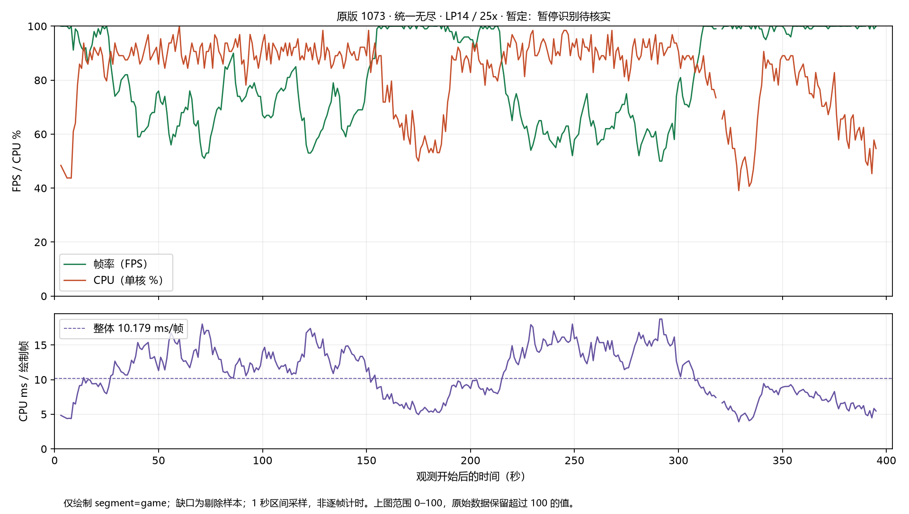
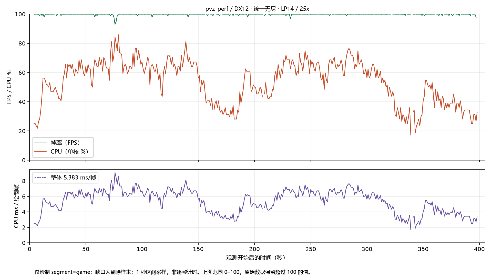
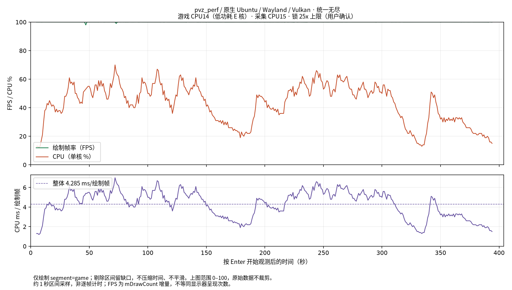

# 性能总账

按机制登记已落地变化；超过 10% 才单列优化成果。最终测量结果不设该门槛，
无论提升、持平或退化都更新同口径的现行结果。日期与提交号仅定位证据。

## 当前项目固定绘制结果

**Windows x64 / Win32 / DX12，LP14、`0x4000`、锁 11x，用户实机确认。**
本轮项目采用 Release/LTO，关闭图形校验和 RTSS，预热 128 次，
每轮 640 个固定 Draw 样本。
固定 32 植物、40 僵尸、3047 张 GPU 纹理；每轮的状态与纹理数量守恒。
下表统计值为两轮各自中位数或 p90 再取中位数。

| 指标 | 当前项目值 |
| --- | ---: |
| CPU Draw 中位数 | 2303.925µs |
| CPU Draw p90 | 2453.100µs |
| 线程周期中位数 | 7065293.25 cycles |
| 固定画面检查 | 1,920,000 字节，零差异 |
| Pool 功能 | 本次四轮均 exit=0，功能通过 |

这是当前固定绘制负载的项目实测值。测量使用显式开启 smoke 的产物，正式交付重新构建
`PVZ_ENABLE_GAME_PROBES=OFF`。计时只覆盖 `DrawScreen`，不含
flush/fence/readback，不是整局 CPU 占用或实玩 FPS。
原始证据：[运行条件与逐帧 CSV 清单](../Tests/evidence/release-fixed-draw-20261017-35dece7b/runs.json)；
此处保留原始文本输出、采样和运行清单，清单中的被测二进制以哈希标识，不保留程序副本。
日志中的现代项目冻结旧版对照仅作历史原件留存，
不再作为本文任何子项的现行基线，也不从该对照发布当前变化百分比。

## 实玩测量：credits 与统一无尽

本节按场景汇总 Windows 原版 1073、当前项目 Windows Win32/DX12 和
当前项目原生 Ubuntu Wayland/Vulkan 的真实实测。Windows 两者构成原有串行对照，
Ubuntu 为独立平台记录；表格并列用于查阅，不表示三者已完成同核同条件对拍。
日期仅用于定位证据。本轮 11x credits 和无尽已由用户取消。

Windows 双方均使用 LP14（`0x4000`），按用户指定的 **25x** 进行，不换算具体频率；
观测覆盖 2026-10-17 至 2026-10-18，使用 Tests 根目录的统一无尽存档。
无尽只统计 CSV 中 **`segment=game`**，开始等待、暂停、后台与其他场景不计入。
Windows credits 项目版因场景标记未更新而被误分类，按 credits 节的人工确认区间重算，
不混入菜单数据。

### Ubuntu 环境与公共采集口径

本轮按用户操作串行测量 credits → 统一无尽：在采集终端按 Enter 开始，
不设时长上限，退出游戏结束。只统计原始 CSV 的 **`segment=game`**，并校验
`valid=1`、前台状态及场景编号；credits 为场景 6，无尽为场景 3、模式 58。
没有沿用 Windows credits 的历史 `other-scene` 修正规则。

环境为原生 Ubuntu 25.10、内核 6.17.0-41-generic、Core Ultra 9 185H、
GCC 15.2、Release/LTO、`PVZ_ENABLE_GAME_PROBES=OFF`，图形后端为 Vulkan。
游戏所有线程绑定 **Linux CPU14（Core ID32，APIC ID64，低功耗 E 核）**，
采集器绑定 **Linux CPU15（Core ID33，APIC ID66）**。
初始化发现一个 `pvz_per:disk$0` 工作线程自行放宽亲和性，采集前已重新绑定；
有效采样期间逐线程检查亲和性，未发生偏离。

**本轮按“锁 25x 最高倍频上限”登记，用户实机确认。** CPU14/15 的硬件最高频率及
系统允许上限均为 2.5 GHz；这是最高倍频限制，允许运行时降频，不表示全程固定在最高频率。
有效区间的 `scaling_cur_freq` 瞬时读数约为 1.10–2.52 GHz，读数含估计波动，
不是整段频率或驻留时间。采集器自身没有设置倍频，原始元数据保持原样；
25x 上限的用户确认单独补记在本说明及派生汇总中。
当前 Windows 记录没有 LP14 的 APIC ID，尚未证明跨系统同号核心的物理身份一致。

三方采用相同的整进程汇总公式：有效区间进程 CPU 时间及绘制帧数分别累加，再求
`总 CPU 时间 × 1000 / 总绘制帧数`；整体 FPS 和 CPU 占用按实际区间时长加权，
不对各秒的 CPU ms/帧直接求算术平均。Windows CPU 时间来自 `GetProcessTimes`，
Ubuntu 来自 `/proc/<pid>/stat` 的 user+system 累计 tick，100 tick/s。
两者均包含进程全部线程、以单核为 100%；Ubuntu 约每秒采样一次，存在 tick 量化。
相同计算公式不保证跨系统图形驱动、音频及其他服务的 CPU 记账归属相同。
FPS 为已有 `mDrawCount` 增量，表示生成的绘制帧，不代表显示器实际呈现次数。

### credits 实测

Windows credits 仅保存采样与 CPU/帧统计，不生成图片。证据目录：
[`Tests/evidence/credits-25x-20261018-001320`](../Tests/evidence/credits-25x-20261018-001320/)。
双方采用音乐 100、音效 65、未静音，窗口模式、不等垂直同步；不传 `-nosound`。

| 程序 / 平台 | 有效样本 | 有效秒数 | 绘制帧数 | 累计 CPU 时间 | 平均绘制 FPS | CPU（单核 %） | CPU ms/绘制帧 |
| --- | ---: | ---: | ---: | ---: | ---: | ---: | ---: |
| Windows 原版 1073 | 160 | 159.999912 | 15,899 | 40.734375 s | 99.369 | 25.459 | 2.562072 |
| 当前项目 Windows Win32/DX12 | 160 | 159.999711 | 15,999 | 26.203125 s | 99.994 | 16.377 | 1.637798 |
| 当前项目 Ubuntu Wayland/Vulkan | 160 | 160.000019 | 15,999 | 11.790000 s | 99.993738 | 7.368749 | 0.736921 |

Windows 双方共同播放区间的**平均每帧 CPU 时间降低 36.075%**，绝对减少约 0.924 ms/帧。
该数字为本次整进程成本对照，不归因于某一项优化。双方均接近 100 FPS 上限，
因此主要收益表现为 CPU 成本下降，不是相同比例的帧率增长。
CPU 时间覆盖所有进程线程，包含更新、绘制和音频；按
`累计进程 CPU 秒数 × 1000 / 累计绘制帧数` 计算，
不把各秒的 CPU/帧直接算术平均，也不把墙钟帧间隔当 CPU 时间。
采样间隔约 1 秒，明细中的每帧值是区间均值，未采集每一帧的独立耗时。

**`other-scene` 原因和筛选依据：**
被测版本的 `pvzPerf/LawnApp.cpp::ShowCreditScreen()` 创建 `CreditScreen` 并注册 Widget，
但没有将 `mGameScene` 改为 `SCENE_CREDIT=6`；本次从奖励界面进入后，
项目整个播放期间仍记录为 `SCENE_AWARD=5`。采样器只接受场景 6，
于是原始项目汇总报告 `no-valid-game-samples`，这是场景分类失败，不是没有绘制。
该入口现已补上 `mGameScene = GameScenes::SCENE_CREDIT`，在创建 credits 界面前设置，
后续采样可以按场景 6 正常分类；本轮历史原始记录仍保留当时的误分类，不回写。

依据用户确认两次均播放 credits、统一约第 3 秒开始的操作，以及源码的场景赋值缺失，
取双方共有的**采样终点约第 4–163 秒**，各 160 个样本：
原版要求原始 `segment=game`，项目要求原始 `scene=5` 且 `segment=other-scene`；
两者均要求区间前后采样端点在前台。
原版约第 164 秒的额外有效样本不纳入共同对照；
项目约第 164 秒起的菜单、后台、开始等待均排除。
这不是将所有 `other-scene` 视为 credits 的通用规则。
原始 CSV 没有逐秒记录 `mCreditScreen` 指针或播放位置，
因此项目 credits 归属依赖人工确认与源码核对；
单轮串行对照、非逐帧对齐，不声称重复 ABBA 或亚秒级中断已完全消除。

原始 `samples.csv`、`measurement.json` 和 `results.json` 均保留原值。
独立重算证据：[汇总与筛选说明](../Tests/evidence/credits-25x-20261018-001320/analysis-summary.json)、
[原版逐区间 CPU/帧](../Tests/evidence/credits-25x-20261018-001320/original-credits-analysis.csv)、
[项目逐区间 CPU/帧](../Tests/evidence/credits-25x-20261018-001320/project-credits-analysis.csv)、
[证据文件 SHA256 清单](../Tests/evidence/credits-25x-20261018-001320/evidence-manifest.json)。
重算入口为 `Tests/performance/analyze-credits.py`，与原始样本一起保留来源和可复现方法。

Ubuntu credits 直接按 `segment=game`、`valid=1`、前台及场景 6 筛选，
没有沿用 Windows 历史 `other-scene` 修正规则。剔除开始等待 2 个、后台 1 个、
其他场景 2 个样本；单秒 FPS 最低 98.996、p10 为 99.990，单秒 CPU 峰值约 12.000%。
平均绘制速率接近 100 FPS，进程 CPU 成本为 0.736921 ms/绘制帧；
数值低于本表 Windows 记录，但核心物理身份、后端、音频和实际频率条件未对齐，
不能据此认定跨系统优化收益，也不发布跨系统提升百分比。

Ubuntu credits 证据：[原始 CSV](../Tests/evidence/linux-wayland-20261018/credits-raw.csv)、
[区间 CPU/帧](../Tests/evidence/linux-wayland-20261018/credits-analysis.csv)、
[统计汇总](../Tests/evidence/linux-wayland-20261018/summary.json)。
credits 不生成图片，完整环境、哈希和统计口径见本节公共说明。

### 统一无尽实测：时间曲线与每帧 CPU 成本

每个程序单独成图：上半幅在同一坐标系叠加帧率和 CPU 占用，纵轴均为 0–100；
下半幅为每个有效采样区间的平均 CPU ms/绘制帧。横轴从按 Enter 开始观测计时，
未压缩时间轴；剔除区间留缺口，不跨暂停连线。原始 CSV 保留超过 100 的值，
不裁剪数据、不平滑。FPS 为游戏已有 `mDrawCount` 增量，代表生成的绘制帧，
不代表显示器实际呈现次数。

**原版 1073（暂停识别暂定）：**

**当前项目 Win32/DX12：**

**当前项目 Ubuntu Wayland/Vulkan：**

| 程序 / 平台 | `game` 样本 | 有效秒数 | 绘制帧数 | 累计进程 CPU 时间 | 平均绘制 FPS | CPU（单核 %） | 平均 CPU ms/绘制帧 |
| --- | ---: | ---: | ---: | ---: | ---: | ---: | ---: | ---: |
| Windows 原版 1073（暂定） | 391 | 391.000513 | 31,678 | 322.437500 s | 81.018 | 82.465 | 10.178594 |
| 当前项目 Windows DX12 | 393 | 393.000051 | 39,261 | 211.328125 s | 99.901 | 53.773 | 5.382648 |
| 当前项目 Ubuntu Wayland/Vulkan | 390 | 390.000130 | 38,997 | 167.110000 s | 99.992274 | 42.848704 | 4.285201 |

计算方式：区间 CPU 时间 = `cpu_percent / 100 × interval_s`；
区间绘制帧数 = `draw_fps × interval_s`；
**整体 CPU ms/帧 = 有效区间 CPU 时间之和 × 1000 / 有效区间绘制帧数之和**。
整体占用和 FPS 也以有效区间累计时间加权，不能直接平均各秒的 ms/帧。
这是整个进程的 CPU 时间，包括更新、绘制、音频及其他线程，不是单独 Draw 的耗时，
也不是包含等待的墙钟帧间隔。现有数据以 1 秒间隔采样，无法还原每一帧的独立 CPU 耗时；
分析 CSV 提供的是该秒内每个绘制帧的平均 CPU 成本，不伪造逐帧记录。

Windows 项目剔除开始等待 2 个、暂停 3 个、后台 1 个、其他场景 6 个样本；
其中约 208 秒和 340 秒的暂停点已排除。原版剔除开始等待 2 个、
后台 3 个、其他场景 7 个样本。采样端以端点状态分类，
不足一秒的中断和状态切换所在区间仍可能混入，图不证明闪屏已解决。

**结论边界：** 本轮只有原版→项目一对串行观测，未完成重复 ABBA。
原版 Board 字段偏移读出不合理的波次、阳光等值，暂停识别仍须核实，
因此原版曲线和数值均为现有记录的暂定统计，不发布正式跨程序提升百分比。
项目设置为静音，原版声音状态未记录，音频条件尚未对齐；
双方均未使用 `-nosound`。这些限制不妨碍保留本轮原始测量，但不能声称严格同条件性能对拍通过。
Ubuntu 为同场景的独立实测，不构成严格同条件 Windows 对照；X11 尚未实测，
不用固定 Draw 或历史数据补填。用户已取消本轮 11x 实玩测量，不再安排。

证据：[计算汇总](../Tests/evidence/windows-endless-25x/summary.json)、
[文件哈希](../Tests/evidence/windows-endless-25x/manifest.json)、
[原版原始 CSV](../Tests/evidence/windows-endless-25x/original-raw.csv)、
[项目原始 CSV](../Tests/evidence/windows-endless-25x/project-raw.csv)、
[原版区间 CPU/帧](../Tests/evidence/windows-endless-25x/original-analysis.csv)、
[项目区间 CPU/帧](../Tests/evidence/windows-endless-25x/project-analysis.csv)。
原始测量元数据和项目 settings 与上述文件同目录，保留被测 EXE 哈希。
图与汇总可用 `Tests/performance/report-windows-game-perf.py` 从原始运行目录重新生成。

Ubuntu 无尽按 `segment=game`、`valid=1`、前台、场景 3 和模式 58 筛选。
剔除开始等待 2 个、后台 2 个、其他场景 10 个样本；有效区间覆盖第 0–20 波，
单秒 FPS 最低 98.011、p10 为 99.989，单秒 CPU 峰值约 69.997%。
整段平均绘制速率接近 100 FPS，没有持续满核的证据；区间统计不代表独立逐帧耗时，
也不能归因为某项代码优化的收益。Ubuntu 曲线沿用上述时间轴和缺口规则，
下半幅另以虚线标出整体 CPU ms/绘制帧均值，不跨暂停连线。

Ubuntu 无尽输入仍为 `Tests/game3_58.dat64`，SHA256 为
`0de22ff708e3f572a669a15cb138076148f59628f073e7cef46ffb252d96429a`，
每轮复制为独立玩家 ID1 的 `game1_58.dat64`；没有让游戏直接读写仓库基准。
玩家详情来自人工构造的全通关测试档，不代表 Windows 原玩家档完全相同。

Ubuntu 无尽证据：[原始 CSV](../Tests/evidence/linux-wayland-20261018/endless-raw.csv)、
[区间 CPU/帧](../Tests/evidence/linux-wayland-20261018/endless-analysis.csv)、
[无尽矢量图](../Tests/evidence/linux-wayland-20261018/endless-timeline.svg)、
[统计汇总](../Tests/evidence/linux-wayland-20261018/summary.json)。

### 跨平台比较限制与 Ubuntu 公共证据

Ubuntu 每个场景只有一次观测，没有重复 ABBA，也没有跨系统按播放位置或逐波时间对齐。
Linux/Vulkan/GCC 与 Windows/DX12/MSVC 的渲染、编译及运行库不同，核心物理身份和
实际运行频率条件尚未对齐，**不发布 Windows/Linux 提升百分比**。
采集未传 `-nosound`，但未随采样保存当时的音量和 `customScale` 开关快照；
证据目录的 `settings-after-run.json` 仅为事后快照（音量 85/55、未静音、
`customScale=0`），不能倒推整个测量期间的设置，也不能宣称已与 Windows 音频条件对齐。
`scale.json` 副本与两轮采集记录的配置哈希一致，但配置文件本身不证明缩放开关当时开启。
硬件频率上限和 APIC ID 清单同样标为事后核对。

Ubuntu 原始数据、元数据和哈希均归档，不保留程序副本：
[统计汇总](../Tests/evidence/linux-wayland-20261018/summary.json)、
[文件哈希](../Tests/evidence/linux-wayland-20261018/manifest.json)、
[全部核心最高频率及 APIC 清单](../Tests/evidence/linux-wayland-20261018/environment-after-run.json)。
两场原始 CSV、区间 CPU/帧和无尽曲线分别链接于对应场景。
可复现分析入口为 `Tests/performance/report-linux-game-perf.py`，只为无尽生成图片，
credits 保留原始记录、区间 CPU/帧与汇总，不生成图片。X11 尚未实测。

## 口径与证据

- 当前固定 Draw 实测环境为 **LP14、`0x4000`、锁 11x**，用户已亲自核实；无尽实玩本轮按用户指定的 **25x** 测量。锁核本身不证明锁倍频，两种结果不互相外推。
- 除固定 Draw 与当前实玩表外，下文所有子项的耗时、容量、体积及收益数字均为历史证据，本轮未重测，当前项目对应值待更新。历史“新机制”列不是当前项目实测列，禁止用旧现代构建值填补当前结果。
- 保留原版算法或原机制 → 已落地算法的确切历史对拍，用于说明原理及原轮收益；历史数字只属于原轮，既不充当现代冻结基线，也不代表当前 1073 整程序对照。
- “锁定对拍”沿用原轮确认；无法确认原轮锁定条件的数字明确标为“历史未复测”，不登记为当前有效收益。LP15、未锁历史不改称 LP14 锁 11x。
- 常规微基准：MSVC x64 `/O2`，N=2M、min-of-5、两进程复核、差异超过 5% 重跑、统一 noinline、两侧 checksum 相同；九轮 AB/BA 与游戏逐帧协议另列。
- 降低率为 `(旧耗时－新耗时)/旧耗时`。不把新/旧耗时百分比误写成降低率，不跨负载、冷热状态、构建或统计量拼接收益，不外推整局 FPS。
- 访问器清理、自行引入又删除的虚函数、功能门禁、无匹配有效对照和不超过 10% 的微改不列成果。
- 下文 `B/` 指现存原始日志目录 `../../_shared/bench35/`（相对本文件）；各行给出目录与文件名。Git `ae5caaeb` 保存该批复核与统一符号口径，`b0d78ac9` 保存锁定遍历基准及实现。日志和 Git 证据均不依赖其他 Markdown 文档存续。

## 名字数值化：reanim 先行，particle 沿用

### reanim 名字枚举、MPHF 与 attacher 段表

测量状态：本节全部子项为历史证据，本轮未重测，当前项目值待更新。

**名字枚举首先在 reanim 落地。** 原逐 tick 轨道名字扫描、attacher 文本解析改为 `ReanimTrackId`、联合键 MPHF 和编译期整数段表；粒子随后采用枚举与区间。IDT5 装载清理是后续变化，不能覆盖或替代这一收益。

| 原机制 → 已落地机制 | 对拍或容量变化 | 范围与证据 |
| --- | --- | --- |
| `strnicmp` 线性轨道扫描 → `(type,id)` MPHF 直达、零字符串零回退 | 原始记录 65–262ns/查 → 全路径 2.92–4.13ns/查 | **历史未复测**：原轮锁定与逐路径配对未重新核实，保留原始收益记录，不据区间端点算新倍率。credits 约 3400 万次/轮是旧负载；Git `74279f21`、`aeb80da3`、`91f40433`，历史测量汇总 `ac6fe907` |
| 每类型 MPHF → 全局共享单表 | 约 154KB → 44KB，减少约 110KB（71%） | 表容量估算，非进程驻留内存；Git `487a3a0d`、`5739a3cd` |
| 每 tick 文本解析、每实例动作缓存 → 编译期整数段、资源共享缓存 | 缓存约 19KB/实例 → 2.4KB/资源；锁定轮新实现 `UpdateAttacherTrack` 379ns | 容量的共享粒度改变；379ns 仅是满员 credits 新路径成本，没有同场景旧值，不登记耗时倍率。Git `de7172f6`、`4d0602ad`、`b0d78ac9` |

名字接口与查找见 `pvzPerf/Sexy.TodLib/Reanimator.cpp`、`ReanimTrackId.h`、`ReanimTrackMphfGlobal.h`。attacher 隐藏值按原始帧语义处理，重复 ID 轨道也须保留；名字消除不等于合并同名轨道。旧未锁绝对成本不能与 379ns 相减。

### 粒子枚举、前缀区间与定义直索引

测量状态：本节全部子项为历史算法对拍，本轮未重测，当前项目值待更新。

原字符串精确/前缀比较 → 字典序名字枚举与左闭右开区间：`unnamed=0`、112 个具名 ID、`top=113`；All 为 `[unnamed,top)`，不占枚举。运行时和 compiled 删除名字、名字长度及 `mOnDuration` 死槽。精确 CrossFade 用首见定义索引；Override 仍扫描活实例，定义下标不能替代运行实例下标。

**锁定对拍**：LP14 锁 11x，原轮用户现场确认；程序记录处理器号 14。MSVC C++23 `/O2 /Ob2 /DNDEBUG /GL- /fp:precise /OPT:NOICF`，同一程序和 112 系统/222 定义语料，预热后九轮 AB/BA，QPC；每轮命中与输出 checksum 相同。下表均为九轮中位数，单位 ns/查询，降低率取两侧中位数之比。

| 路径/负载 | 旧机制耗时 | 新机制耗时 | 降低 |
| --- | ---: | ---: | ---: |
| 小系统匿名：空名 `_stricmp` → ID 相等 | 32.136155 | 18.318769 | 43.0% |
| 小系统匿名：旧首字节快路 → ID 相等 | 24.220093 | 18.277248 | 24.5% |
| 小系统具名精确：字符串 → ID 相等 | 66.470412 | 19.359554 | 70.9% |
| 小系统前缀：`strlen` + `_strnicmp` → 区间 | 92.634290 | 18.383265 | 80.2% |
| 小系统前缀：缓存长度 + `_strnicmp` → 区间 | 50.470242 | 18.306419 | 63.7% |
| 全语料匿名：空名 `_stricmp` → ID 相等 | 35.652610 | 18.820831 | 47.2% |
| 全语料匿名：旧首字节快路 → ID 相等 | 25.232980 | 18.788132 | 25.5% |
| 全语料具名精确：字符串 → ID 相等 | 112.898488 | 22.828038 | 79.8% |
| 全语料前缀：字符串 → 区间 | 122.317453 | 20.820691 | 83.0% |
| `gloom_` 所属系统：前缀字符串 → 区间 | 335.034964 | 45.899545 | 86.3% |
| `icetrap` 所属系统：前缀字符串 → 区间 | 90.341566 | 25.540467 | 71.7% |
| `awardray` 所属系统：前缀字符串 → 区间 | 567.046612 | 56.283233 | 90.1% |
| `doommushroom` 所属系统：前缀字符串 → 区间 | 508.619777 | 47.223432 | 90.7% |
| 小系统定义首见：字符串扫描 → 预建 ID 直索引 | 43.883524 | 5.989850 | 86.4% |
| 全语料定义首见：字符串扫描 → 预建 ID 直索引 | 68.832877 | 6.376767 | 90.7% |
| FadeOut：五个含目标的两定义系统，字符串扫描 → 直索引 | 48.643760 | 5.977852 | 87.7% |
| FadeOut：全语料合成缺失主导负载，字符串扫描 → 直索引 | 29.648333 | 5.964516 | 79.9% |

证据：基础 [results.json](../Tests/evidence/particle-emitter-microbench-20261010-160239-749/results.json)、[samples.csv](../Tests/evidence/particle-emitter-microbench-20261010-160239-749/samples.csv)、[run-metadata.json](../Tests/evidence/particle-emitter-microbench-20261010-160239-749/run-metadata.json)；FadeOut [results.json](../Tests/evidence/particle-emitter-fadeout-20261010-161157-045/results.json)、[samples.csv](../Tests/evidence/particle-emitter-fadeout-20261010-161157-045/samples.csv)。实现：`pvzPerf/Sexy.TodLib/TodParticle.cpp::CrossFade/OverrideColor`、`TodParticle.h::mEmitterIndexByName`。

边界：一次查询仅扫一个系统；小系统 1–8 定义、平均约 1.72–2.89，全语料组也不是每次扫 222 项。热缓存模型含选择、16 字节颜色写入和共同计数，不含分配、交叉淡化执行或渲染；直索引每系统定义 113 个 int（452B），建表不计时。基础/补测分别 4.156/0.676 秒。All 原本跳过比较，无超过 10% 收益；枚举线性找定义的中间方案不另算已落地直索引的收益。

## 遍历、索引与连续存储

测量状态：本节全部子项为历史算法对拍，本轮未重测，当前项目值待更新。

以池为单一真值，生命周期维护派生桶/名册；键直取缩短扫描，连续槽号减少节点→ID→池槽的依赖加载。下表为已有锁定对拍；本次未复测。

| 原机制 → 已落地机制 | 旧 → 新 | 降低 | 范围与证据 |
| --- | --- | ---: | --- |
| reanim 全轨 112B 步长扫描 → 256 位活动掩码跳过 | 32.3 → 3.12µs/pass | 90.3% | 稀疏活动负载，非满员整局 Update；Git `b0d78ac9`，`Tests/performance/bench_reanim_trackwalk.cpp` |
| reanim 每个绘制组全扫 → 分组占用位跳过 | 163.3 → 58.6µs/pass | 64.1% | 独立分组基准，不与上一行相减；Git `ae5caaeb`，`Reanimator.cpp::mGroupOccMask` 相关路径 |
| 僵尸高水位全池扫 → 连续 uint16 行段、反索引、Boss 侧数组 | 2733.4 → 592.8ns | 78.3% | 池 1024×168B、本行 171；链跳对照 884.5ns；Git `ef28072e`、`b0d78ac9` |
| 植物高水位扫 → 每格四层桶、按需重扫维护 | 183.31 → 24.97ns | 86.4% | 48 植物夹具；`B/cellbucket/bench_cellbucket.lpe.out`，Git `ae5caaeb` |
| 发射器/粒子 TodList 指针链 → uint16 紧凑名册 | 132.2 → 2.42µs/pass | 98.2% | 900 粒模型；尾存倒序保持 AddHead 顺序，非 98 倍；Git `b0d78ac9`，`Tests/performance/bench_particle_roster.cpp` |
| 每删一粒 Find 扫槽 → 已知迭代下标传入 DeleteParticleAt | 801.5 → 550.3ns | 31.3% | churn 删除；级联漂移仍校验、必要时重新找槽；同上 |

实现：`pvzPerf/Sexy.TodLib/Reanimator.cpp`、`TodParticle.cpp`、`pvzPerf/Lawn/Board.cpp`。活动掩码须含编译期 attacher 位与重复轨道、访问自愈和附件兜底；256 位覆盖原语料最大 171 轨。行段保持池顺序与 first-match，候选超集仍须真实行过滤；整池清空须同步重建桶。旧未锁名册/更新环数字不再并列为有效基线。

### 附件平面遍历

测量状态：以下为历史算法对拍，本轮未重测，当前项目值待更新。

显式 DFS 栈与不可达附件嵌套分支 → 平面 for 和可达效果分支。锁定 LP14 复核，N=2M、min-of-5、AB 交错、checksum 相同；数据取 `B/todlib/bench_attachment.lpe.out`，实现 `pvzPerf/Sexy.TodLib/Attachment.cpp`，Git `ae5caaeb`。

| 路径 | 旧 → 新 ns | 降低 |
| --- | --- | ---: |
| Update | 42.81 → 26.51 | 38.1% |
| SetPosition | 81.80 → 33.69 | 58.8% |
| SetMatrix | 257.14 → 41.76 | 83.8% |
| Draw | 43.03 → 30.64 | 28.8% |
| AttachmentDie：移除不可达嵌套分支 | 35.72 → 30.62 | 14.3% |

边界：夹具每附件一个效果，均匀 `{particle,trail,reanim,other}`，下游为空桩，仅验证分发与遍历；当前 trail 已退役，不能将这组历史模型当当前效果混合比例。OverrideColor 同轮反而变慢，不计全族普遍加速。

## 分支分发与常量表

测量状态：本节两表的全部子项为历史算法对拍，本轮未重测，当前项目值待更新。

原 switch/if 常量赋值链 → static 常量数据表；行为 case → 函数指针表。MSVC 的连续枚举跳转表、区间判断不必更慢，只登记逐项对拍胜出的路径。以下是已有 LP14 锁 11x 复核；`B/` 日志两侧 checksum 相同，DrawBossPart 另据同构 body 的历史复核，不冒充该批 checksum 验证。Git `ae5caaeb`。每行仅对应夹具的键分布、桩与调用范围，不代表完整函数或游戏同比加速。

| 路径：旧链/分派 → 新表 | 旧 → 新 ns/次 | 降低 | 原始日志（B/ 下） |
| --- | --- | ---: | --- |
| 植物发射物类型 kFireProjectiles | 44.40 → 7.12 | 84.0% | `r4/bench02_fireproj.lpe.out` |
| 范围伤害旗 kDamageRangeFlags | 33.08 → 6.89 | 79.2% | `r4/bench01_dmgflags.lpe.out` |
| 商店价格 kStoreItemCosts | 40.25 → 9.22 | 77.1% | `r4/bench15_storecost.lpe.out` |
| 花盆高度/缩放 kFlowerPotAdjust | 34.12 → 8.96 | 73.7% | `r4/bench04_flowerpot.lpe.out` |
| 僵尸图像偏移 kZombieImageOffsetFix | 33.12 → 9.53 | 71.2% | `r4/bench06_zimgoff.lpe.out` |
| 投射物绘图参数 kDrawParams | 48.35 → 15.42 | 68.1% | `r4/bench10_prodraw.lpe.out` |
| 种子包绘图指标 kSeedPacketDrawMetrics | 62.63 → 26.77 | 57.3% | `r4/bench05_packetdraw.lpe.out` |
| 行走头部位置 kWalkHeadPos | 30.49 → 14.66 | 51.9% | `r4/bench07_walkhead.lpe.out` |
| 发射节奏 kShootingCounter | 30.06 → 15.72 | 47.7% | `r4/bench03_shootctr.lpe.out` |
| 投射物阴影 kShadowParams | 89.66 → 59.93 | 33.2% | `r4/bench11_proshadow.lpe.out` |
| 投射物直接绘制 kImmediateRender | 25.59 → 18.25 | 28.7% | `r4/bench12_proimmediate.lpe.out` |
| 直飞判定 kDynamics（同表另一消费者） | 25.58 → 18.18 | 28.9% | `r4/bench13_dynamics.lpe.out` |
| 种子成本覆盖 kSeedCostOverrides | 39.48 → 32.87 | 16.7% | `r4/bench14_seedcost.lpe.out` |
| 植物更新分派 kSeedTypeUpdates | 56.11 → 48.16 | 14.2% | `r4/bench08_seedupdate.lpe.out` |
| 盆栽高度偏移 → static 表 | 31.79 → 8.49 | 73.3% | `ifelse/bench2_potoffset.lpe.out` |
| 植物高度 → static 表 | 27.21 → 11.72 | 56.9% | `ifelse/bench7_plantheight.lpe.out` |
| 植物阴影 → static 表 | 40.46 → 22.89 | 43.4% | `ifelse/bench5_plantshadow.lpe.out` |
| 发射原点 → static 表 | 44.31 → 36.86 | 16.8% | `ifelse/bench8_fire.lpe.out` |
| Coin 绘制 → static 表 | 66.84 → 56.91 | 14.9% | `ifelse/bench4_coindraw.lpe.out` |
| DrawSeed 选择 → static 表 | 32.98 → 29.06 | 11.9% | `ifelse/bench1_seedpacket.lpe.out` |
| 调色板模式 SetColorMode | 26.74 → 8.67 | 67.6% | `ui/bench13_ZombatarColors_SetColorMode.lpe.out` |
| 分类高亮 DrawCategoryHighlight | 45.56 → 19.16 | 57.9% | `ui/bench11_ZombatarItems_DrawCategoryHighlight.lpe.out` |
| BeghouledPickSeed 种子选择 | 117.29 → 51.98 | 55.7% | `ui/bench07_Challenge_BeghouledPickSeed.lpe.out` |
| 禅园 DrawPlantOverlay | 31.06 → 21.06 | 32.2% | `ui/bench09_ZenGarden_DrawPlantOverlay.lpe.out` |
| SquirrelFound | 93.51 → 72.57 | 22.4% | `ui/bench08_Challenge_SquirrelFound.lpe.out` |
| Plant::DoSpecial | 48.02 → 37.31 | 22.3% | `ui/bench02_Plant_DoSpecial.lpe.out` |
| DrawBossPart 五 case 级联 → 五槽函数表 | 18.2 → 7.33 | 59.7% | Git `50201e46`，同构单层 body、五槽均匀、七跑一致 |

ifelse 行取原始 A 与最终 C(static)，不取曾经栈物化的 B；收益相对原始链计算。实现分别在 `pvzPerf/Lawn/{Plant,Zombie,Projectile,SeedPacket,Coin,ZenGarden,Challenge,CursorObject}.cpp` 与 `pvzPerf/Lawn/Widget/{StoreScreen,ZombatarColors,ZombatarItems}.cpp`。

以下原始输出为循环**总耗时**，另列以免冒充 ns/次；同属上述锁定复核与范围限制。r3 为预热后 min-of-5；r2plant 的 r1/r2 是同进程两轮，各取 min-of-5，降低率按两轮最小值计算，不补称两进程复核。

| 原分派 → 已落地表 | 旧 → 新总耗时 | 降低 | 原始日志（B/ 下） |
| --- | --- | ---: | --- |
| CursorObject::Draw → kCursorDrawCases | 120935300 → 99015400ns | 18.13% | `r3/t16_cursor.lpe.out` |
| BossSpawnAttack → kBossSpawnTracks | 482260400 → 403634500ns | 16.30% | `r3/b_zombie_events.lpe.out` |
| BossHeadSpit → kBossHeadTracks | 505164300 → 448182900ns | 11.28% | 同上，独立 case |
| 玉米炮状态 → kCobCannonStateCases | 两轮 22575300/22540800 → 20225800/20251500ns | 10.27% | `r2plant/bench_plant.lpe.out` |
| 仙人掌状态 → kCactusStateCases | 两轮 69724900/69238900 → 57673300/58129700ns | 16.70% | 同上 |

## 数值记录解码与产物体积

测量状态：本节解码耗时、请求量及产物体积均为历史证据，本轮未重测，当前项目值待更新。

reanim 原 IDT4 非字幕文本、长度槽和临时字符串构造 → IDT5 数值元数据、编译期 ID 与段表，真实 UI 字幕保留。**锁定对拍**：LP14 锁 11x，用户原轮确认；MSVC `/O2 /Ob2 /GL- /fp:precise /OPT:NOICF`，146 记录/2694 轨/404950 帧，九轮 AB/BA；两侧 checksum 均为 `7103195926588035581`。总进程 5.240 秒，前后同负载探针差约 0.37%。

| 模型路径 | 旧中位数 → 新中位数 | 成对变化中位数 |
| --- | --- | ---: |
| resident decode | 44.5916 → 32.1947ms | -27.9249% |
| resident CRC + decode | 143.6580 → 122.6496ms | -14.6380% |

证据：[results.json](../Tests/evidence/string-numeric-resume-20261010/reanim-metadata-final/results.json)、[samples.csv](../Tests/evidence/string-numeric-resume-20261010/reanim-metadata-final/samples.csv)、[run-metadata.json](../Tests/evidence/string-numeric-resume-20261010/reanim-metadata-final/run-metadata.json)，同目录上级 `frequency-before.log`、`frequency-after.log`。百分比是逐对变化中位数，不能用两侧中位数重算后混称同一统计量。

边界：resident 拥有型对象模型，校验/释放在计时外；dummy 资源与容器布局不是游戏 ABI，不含读盘、图像/字体、GPU 上传、完整启动或 FPS。非 UI 字符复制 257 次/10404 请求字节 → 0、临时字符串 259 次/12752 请求字节 → 0；字幕仍 46 次/1008 请求字节。分配请求不等于进程内存，未完成的实际游戏装载配对不补作本项验收。

粒子 compiled 原指针结构转储与名字死槽 → 无指针标量/轨道体、数值区间：112 份旧 v4 **273092B → 114860B，减少 158232B（57.94%）**。这是文件体积，非装载速度或常驻内存；首见定义索引另有每系统 452B 运行时容量。Git `ac6fe907` 保存该 v4 基线；现存 `Tests/evidence/string-numeric-resume-20261010/image-symbol-compact-20261011/particle-native-verification.json` 验证 112 记录、159 具名/63 匿名发射器、8988 轨道流及新体积。该日志旧基线为 native v2 的 278738B，不能冒充上述 v4 的 273092B。

## 其他历史绘制负载

测量状态：本节全部子项为历史记录，本轮未重测，当前项目值待更新；原轮现代构建间的对照仅供解释机制，不作现行基线。

以下机制已落地，原轮为 Vulkan Survival 历史逐帧对拍；**未核实原轮 LP14 锁 11x，不登记为当前有效收益**。保留同轮可比较原始变化，不拼接为当前整体加速。现行 D3D12/Vulkan 与原图直绘不能直接继承旧绝对值。

| 原机制 → 已落地机制 | 同轮历史对拍 | 范围与证据 |
| --- | --- | --- |
| 每图元即时 Bind/Draw → 相邻同态游程延迟合并，保持混合顺序 | ON/OFF：p50 532.9/621.2µs（-14.2%），p90 723/981（-26.3%），p99 1087/1459（-25.5%），mean 547/668（-18.1%） | 无校验、同构建交替 A/B、约 13.2k 帧；Git `b0d78ac9`、`ac6fe907`，原日志名 `perf-ab/frame_time_merge_{on,off}_20261005.log`，当前目录无该原件 |
| 每帧 CPU 生成 8192px + 上传 → GPU 焦散直写 | 无校验三轮中位 p50：CPU 447.7 → GPU 329.4µs（-26.4%）；独立校验相位 PoolEffectDraw 152.9 → 58.2µs（-61.9%） | 两种统计不混算；6930 帧×8192px 零差异、含负数边界，bits 重传 13200 → 0；Git `b0d78ac9`、`0b3be516` |
| 每纹理独立描述符绑定 → 顶点携带纹理数组槽位 | 同期无校验三轮中位 p50 329.4 → 192.9µs（-41.4%） | 192.9 为原轮冷机；同代码热机约 225–240µs，不能跨冷热比较；Git `b0d78ac9` |
| 采样器交替绑定、逐游程绑顶点流 → 采样器数组、单绑定流 | 同轮热机 p50 230 → 153.1µs（-33.4%），三轮 152–156；frameDraws 23 → 2、绑定 31 → 10 | 历史场景 CPU 绘制成本与提交计数，不是更新率、上屏率或整局 FPS；Git `b0d78ac9` |

实现证据：`pvzPerf/SexyAppFramework/graphics/vulkan/VulkanRenderer.cpp`、`shaders/game_caustic_cs.comp`、`pvzPerf/Lawn/System/PoolEffect.cpp`。焦散必须保持有符号向零除法语义。上述分阶段结果不相加，也不再发布旧“775 → 153、整体提速 80%”结论。

## 历史未复测的算术收益

测量状态：本节全部子项为历史记录，本轮未重测，当前项目值待更新。

| 原机制 → 已落地机制 | 原始记录 | 范围与证据 |
| --- | --- | --- |
| 常值轨仍间接求值 → 单节点 low==high 直返 | 3.90 → 2.75ns，降低 29.5% | 原轮锁定条件未确认；Git `ae5caaeb` 明记该轮未重建代数基准，不登记当前有效收益；`pvzPerf/Sexy.TodLib/Definition.cpp::FloatTrackEvaluate` |
| 每粒每帧 age/(dur-1) → 缓存倒数乘 | 4.58 → 2.76ns，降低 39.7% | 同上；出生、交叉改写、存档读回三处同步倒数，`TodParticle.cpp`、`pvzPerf/Lawn/System/SaveGame.cpp` |
