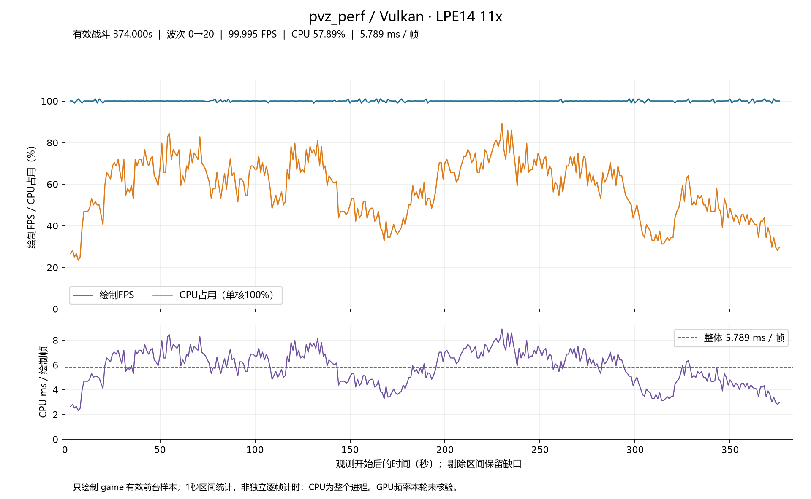
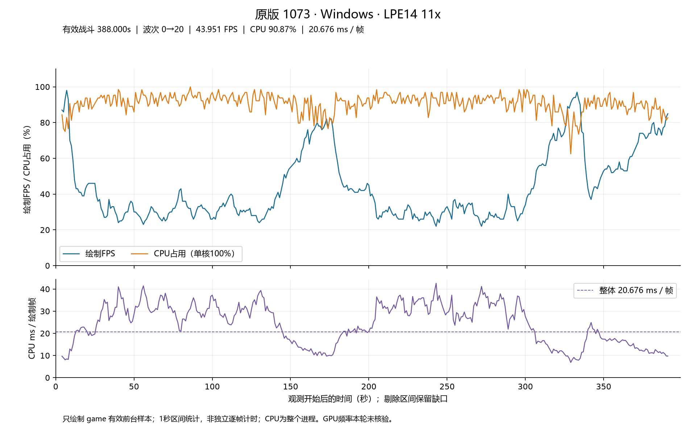

# 性能优化原理与基准

本页按优化原理组织；每节先解释减少了什么工作，再列对应基准与测量边界。3.0与1.0未见明确提升的同口径指标只列3.0；改善明确且口径一致时保留1.0比较。细小波动不登记为新收益。完整历史原始记录继续归档，已退役路径不留在现行性能表中。仍生效的机制先例单独保留；没有新同口径测量时明确标注历史，不因删除旧夹具而删除优化原理。局部表缺少static属于本项目代码缺陷，修复记录见[修复总账](fix-ledger.md)，不列为原版路径的优化收益。

本轮程序版本按3.0登记，存档格式为v4；两者不是同一个版本号。

“原机制模型”“原版代码片段编译”“原版EXE机器码”“当前生产函数”分开标明。不同范围不互相替代，ns/查询、整轮总耗时、CPU Draw和整局成本分别解读。

## 1. 将多段条件选择变成静态参数表

固定枚举到参数的映射可在编译期建表。一次范围检查和下标读取替代多段条件比较；常量数据集中存放，也减少重复业务代码。函数指针表适用于需要不同处理函数的情况，但间接调用本身有成本，不能据此推断所有switch或if-else都应替换。

### 实际原版EXE与当前生产函数

五项查询对同一输入逐项对拍。原版x86机器码在隔离进程以SEC_IMAGE映射到首选地址，绑定受控对象；当前侧链接实际x64 Release /GL /LTCG对象。串行原版—当前—当前—原版，各进程min-of-5，单位ns/查询。

| 查询 | 原版EXE，进程1／2 | 3.0生产函数，进程1／2 |
| --- | ---: | ---: |
| 伤害范围 | 34.490／34.573 | 6.932／6.933 |
| 花盆高度 | 46.656／45.954 | 8.271／8.274 |
| 种子特殊价格，56..74 | 51.459／51.712 | 6.435／6.427 |
| 商店29项有效商品 | 52.271／48.954 | 10.643／10.602 |
| 大头贴调色范围 | 40.837／40.995 | 8.724／8.731 |

输出向量一致，花盆高度核对float位模式。输入包装和checksum计入时间；x86/x64、编译器、ABI、LTO不同，不能把全部差值归于查表。此处种子尾段不是下表的75项成本夹具，商店29项也不是旧31槽输入。[本轮原始结果](../Tests/evidence/v3-final-microbenchmarks-20261029/production/summary.json)、[原版ABI](../Tests/evidence/production-small-benchmarks-20261029/retail-abi.json)。

### 同口径参数选择模型

从当前源码提取实际表声明，放入原夹具；保留原输入和下游桩。MSVC14.51 x64 /O2 /GL-，每进程min-of-5，单位ns/次。它衡量参数选择及共同桩，不是完整Draw/Update。

| 参数表 | 原链模型重测，进程1／2 | 3.0进程1／2 |
| --- | ---: | ---: |
| kDamageRangeFlags | 32.99／32.96 | 6.89／6.88 |
| kFireProjectiles | 43.98／44.58 | 7.12／7.11 |
| kFlowerPotAdjust | 33.98／34.07 | 8.95／8.96 |
| kSeedPacketDrawMetrics | 62.35／62.26 | 26.82／26.76 |
| kZombieImageOffsetFix | 33.09／33.03 | 9.43／9.44 |
| kWalkHeadPos | 30.67／30.84 | 14.64／14.62 |
| kSeedTypeUpdates | 55.27／55.29 | 47.39／47.30 |
| kShadowParams | 89.44／89.52 | 59.72／59.61 |
| kSeedCostOverrides | 39.35／39.37 | 32.70／32.32 |
| kStoreItemCosts | 40.04／40.02 | 10.72／10.72 |
| kPlantHeightOffsets | 27.08／27.09 | 11.71／11.74 |
| kPlantShadow | 43.56／40.39 | 22.85／23.02 |
| kZombatarPaletteRange | 26.70／26.71 | 8.67／8.66 |

这些指标与1.0最终值总体相近，未登记新的跨版提速，故不重复1.0列。商店模型仍均匀输入31槽，其10.72ns级结果不等于29项有效购买业务的完整成本；原版模型、当前表声明与实际函数不混用。本轮13项均通过checksum，全部两进程结果保留。[当前表声明和原始输出](../Tests/evidence/v3-final-microbenchmarks-20261029/table-models/manifest.json)。

## 2. 缩小候选集合，减少全池与全轨道扫描

僵尸行索引、植物每格分层桶直接给出候选对象，原池仍为真值；轨道活动位与分组占用掩码跳过没有工作的槽。关键是维持顺序、first-match、重复同名轨道和附件兜底，避免用改变语义的“更快遍历”替代原功能。

### 对象查询

单位ns/查询，两个独立进程min-of-5。原版侧为实际EXE对象池查询；当前侧使用真实对象布局。本轮使用当前最终布局：Zombie608、Reanimation296、Plant568、轨道实例128、TodParticle184字节。粒子归一化年龄缓存放在16KiB侧表，不增加实例字段。

| 负载 | 原版EXE全池 | 当前3.0实际全池 | 当前3.0索引路径 |
| --- | ---: | ---: | ---: |
| 1024僵尸，本行171 | 8341.852／8346.739 | 6484.886／6485.492 | 3967.744／3965.784 |
| 48植物，54格 | 552.225／553.051 | 259.186／259.090 | 55.751／55.609 |

植物按同一MT19937序列放置并执行两百万查询，四层结果归一化后校验和一致，格桶额外核对54格。僵尸结果均171个。旧168字节僵尸模型与当前布局不同，不拿旧模型结果计算3.0提升。

### 轨道筛选

250实例×30轨道，单位µs/pass；读取当前真实类型，下游为两侧相同的可观察桩。不是完整Reanimation::Update或Draw。

| 负载 | 当前3.0全扫 | 当前3.0掩码 |
| --- | ---: | ---: |
| 0%活动，每实例2条attacher | 49.787／50.391 | 5.877／5.883 |
| 5%活动，每实例2条attacher | 51.475／51.415 | 9.293／9.267 |
| 绘制组，18组／实际占用组 | 216.849／216.189 | 61.209／61.072 |

命中数、下游调用数及原版／当前对象查询checksum一致。本轮Plant全池约259ns，前次约286ns；僵尸行查询约3966ns，前次约3961ns，未见新收益。绘制组全扫约216µs、占用组约61µs，分别高于前次199～201µs和58µs，保留这次劣化观测；不能只选活动轨道筛选变快的结果。两进程差值不单独归因某字段。[本轮真实布局与各轮](../Tests/evidence/v3-final-microbenchmarks-20261029/production/summary.json)。旧112字节轨道、不同附件桩和已退役trail混合模型退出当前数值表。

### 连续粒子名册与附件平面遍历

发射器／粒子遍历使用紧凑槽号名册，替代TodList指针链，减少节点到ID再到对象池的依赖读取；尾存倒序维持原AddHead顺序。更新循环已知槽号时直接传给DeleteParticleAt，避免每次删除重新Find；交叉源级联等下标未知路径仍查找，不能删除必要的兜底。实现见TodParticle.cpp的ParticleRoster和DeleteParticleAt。这是仍在生效的遍历与删除优化，不因结构基准更换就退役。

附件保留固定效果数组，以平面for遍历和可达效果分支取代旧显式DFS栈及不可达嵌套附件处理。实现为Attachment.cpp的UpdateAt、SetPosition、SetMatrix、Draw等；本轮时间域传递变化不等于恢复嵌套遍历。

历史粒子名册模型记录132.2→2.42µs/pass（900粒），已知槽删除模型801.5→550.3ns；它们是旧布局的历史模型，不能冒充当前184字节粒子完整更新。附件历史模型含particle/trail/reanim/other且下游为空桩，trail已退役，因此不恢复为现行混合负载指标。机制保留，旧数据与条件可追溯到[v2.0总账](https://github.com/YuHao2006/pvz_perf/blob/v2.0/docs/perf-fix-ledger.md)及[56项覆盖清单](../Tests/evidence/production-small-benchmarks-20261029/coverage.json)，不将历史模型复跑当成当前生产性能。

## 3. 把字符串身份与重复解析移到编译期

粒子具名查询用枚举，前缀查询用编译期区间，定义首见用直索引；reanim动作、轨道ID和MPHF也在编译期生成。运行期避免重复strlen、字符串比较和全定义扫描。外观变体复用根行为，加载期赋图集指针，不再逐实例复制行为或逐轨覆写图片。

### reanim 名字枚举、MPHF 与 attacher 段表

测量状态：下表为历史先例，3.0最终轮未重测该同口径查名／attacher基准；不与当前帧相位基准混用。

**名字枚举首先在 reanim 落地。** 原逐 tick 轨道名字扫描、attacher 文本解析改为 `ReanimTrackId`、联合键 MPHF 和编译期整数段表；粒子随后采用枚举与区间。IDT5 装载清理是后续变化，不能覆盖或替代这一收益。

| 原机制 → 已落地机制 | 对拍或容量变化 | 范围与证据 |
| --- | --- | --- |
| `strnicmp` 线性轨道扫描 → `(type,id)` MPHF 直达、零字符串零回退 | 原始记录 65–262ns/查 → 全路径 2.92–4.13ns/查 | **历史未复测**：原轮锁定与逐路径配对未重新核实，保留原始收益记录，不据区间端点算新倍率。credits 约 3400 万次/轮是旧负载；Git `74279f21`、`aeb80da3`、`91f40433`，历史测量汇总 `ac6fe907` |
| 每类型 MPHF → 全局共享单表 | 约 154KB → 44KB，减少约 110KB（71%） | 表容量估算，非进程驻留内存；Git `487a3a0d`、`5739a3cd` |
| 每 tick 文本解析、每实例动作缓存 → 编译期整数段、资源共享缓存 | 缓存约 19KB/实例 → 2.4KB/资源；锁定轮新实现 `UpdateAttacherTrack` 379ns | 容量的共享粒度改变；379ns 仅是满员 credits 新路径成本，没有同场景旧值，不登记耗时倍率。Git `de7172f6`、`4d0602ad`、`b0d78ac9` |

名字接口与查找见 `pvzPerf/Sexy.TodLib/Reanimator.cpp`、`ReanimTrackId.h`、`ReanimTrackMphfGlobal.h`。attacher 隐藏值按原始帧语义处理，重复 ID 轨道也须保留；名字消除不等于合并同名轨道。旧未锁绝对成本不能与 379ns 相减。

历史内容可在[v2.0总账](https://github.com/YuHao2006/pvz_perf/blob/v2.0/docs/perf-fix-ledger.md)核对；这里保留仍生效机制及原始边界，不把历史数值改标为3.0新测。

### 粒子身份查询

旧112系统／222定义固定语料，MSVC C++23 /O2 /Ob2 /GL- /fp:precise /OPT:NOICF；两个进程，每侧九轮AB/BA的中位数，单位ns/查询。保留共同选择和颜色写入，不含分配、交叉淡化执行、渲染和建表。

| 负载键 | 字符串／扫描模型（进程1） | 3.0 ID／区间（进程1） | 3.0 ID／区间（进程2） |
| --- | ---: | ---: | ---: |
| unnamed_tiny_1_10 | 32.412910 | 18.282486 | 18.334924 |
| unnamed_fast_tiny_1_10 | 24.199291 | 18.269143 | 18.295992 |
| named_exact_tiny_1_10 | 67.560739 | 19.420149 | 19.423830 |
| family_prefix_tiny_1_10 | 92.682627 | 18.310313 | 18.304285 |
| family_prefix_cached_tiny_1_10 | 50.190150 | 18.294112 | 18.293333 |
| unnamed_full_corpus | 35.585977 | 18.726364 | 18.751938 |
| unnamed_fast_full_corpus | 25.343990 | 18.706495 | 18.702934 |
| named_exact_full_corpus | 112.715856 | 22.790224 | 22.756299 |
| family_prefix_full_corpus | 122.373969 | 20.724446 | 20.712771 |
| family_gloom__own_system | 334.252517 | 45.820303 | 45.848211 |
| family_icetrap_own_system | 90.327975 | 25.418220 | 25.664981 |
| family_awardray_own_system | 567.594231 | 56.347398 | 55.951083 |
| family_doommushroom_own_system | 502.862755 | 47.197817 | 47.205780 |
| find_direct_tiny_1_10 | 44.133408 | 6.173480 | 6.178330 |
| find_direct_full_corpus | 69.077820 | 6.470926 | 6.476640 |
| find_fadeout_present_systems | 48.677837 | 5.975889 | 5.979313 |
| find_fadeout_full_corpus | 29.965493 | 5.939902 | 5.947465 |

与1.0最终机制相比没有明确新提升，故只列3.0。语料未覆盖新增变体，不扩称所有现行粒子定义。[完整固定语料与两进程原始样本](../Tests/evidence/v3-final-microbenchmarks-20261029/table-models/13_bench_particle_emitter_names/)。

NRSC4直接向具名图片／字体／声音变量赋值，运行期ResourceId与ImageSymbolId已退役，旧身份只在离线转换使用。加载后释放CPU解码图片。这里解释减少的工作，没有另测启动时间，不虚构启动提速。

## 4. 合并GPU调用，减少动态数据与重复采样

bindless只减少纹理描述符切换，不会自动合并不同混合状态。Vulkan保留相邻同态绘制顺序，合并可兼容的提交，不按纹理重排半透明图元。

| 优化 | 已落地做法 | 作用范围与限制 |
| --- | --- | --- |
| 普通／additive合批 | 支持dualSrcBlend时统一双源精灵混合；不支持时使用独立管线 | 减少交替混合造成的断批，不减少特效或改变叠加顺序 |
| 透明边缘处理 | 普通图像上传前修补全透明像素RGB | 把原逐fragment邻域采样移出稳定绘制路径，保持alpha与线性采样语义 |
| 专用精灵shader | 直通输入走精简采样，生成图像／滤镜／覆盖率走对应路径 | 避免把字形或特殊输入错误套进普通路径 |
| 四顶点矩形 | 调用点直接提供四角，配静态16位索引 | 每矩形动态顶点从6×40字节降到4×40字节；不在提交期比较顶点去重 |
| 混合索引前缀 | 纯三角形／矩形用静态索引，混合时才物化索引前缀 | 16位限制每批局部地址；超过65536按完整图元拆分，底层缓冲容量保持原设计 |
| 状态复用 | 合批并复用未改变的管线、纹理和裁剪状态 | 不取消有业务语义的局部裁剪 |
| Vulkan 双槽帧资源 | 仅命令／同步对象与动态几何流轮换；复用槽位前等其 fence，所有纹理和渲染目标共用 | 桌面像素／生命周期／同步回归通过，手机整局收益未测；不据此宣称提升 |
| Vulkan 1.3 同步 | 图像／回读屏障改用 Synchronization2，帧、上传和图像批次使用 Submit2；呈现释放的目标阶段为 NONE | 场景回到颜色附件时按已知读写用途同步，不再一律 ALL_COMMANDS；尚无单项提速测量，既有整局数据不代表此改动 |
| 离线图集与上传 | 离线装箱、共享图集、上传后释放CPU解码数据，空上传队列立即返回 | 不把图集面积当作实测显存，不把60秒可行排布称为已证明最优 |
| 泳池 | 静态网格与GPU水波／焦散绘制 | 区别于已撤销的reanim／particle GPU计算 |

同一个7687三角形的固定GPU夹具中，draw／管线绑定计数从1989到185，再到34；提交顺序和内容保持。它是调用结构证据，不是锁频提速倍率。[GPU专项](android-gpu-submission.md)说明实现、像素门槛及原始证据。

reanim插值、三角函数与particle模拟及绘制参数均在CPU；GPU只消费最终几何。颜色压缩、矩形实例、生成图像合批、双帧资源等未进入当前路径的试验不计入已落地收益。

DX12已接入普通精灵专用shader、normal／additive双源合批、四顶点矩形、静态16位索引与混合索引前缀，并复用提交暂存数组及未变的根常量。共享加载路径中的透明边缘修补同样生效。当前DX12场景目标仍为BGRA8：源RGB乘alpha前移到shader后会改变UNORM取整位置，四层叠加对拍容许累计4个字节级色阶差异；覆盖率字形仍保持精确比较。独立RTX 4070渲染检查包括80000顶点跨界拆批和混合图元，不能把检查通过写成已测提速倍率。[DX12验证证据](../Tests/evidence/dx12-gpu-submission-20261029/)。

OpenGL已接入下文的普通贴图硬件采样及状态缓存专项，功能验证见[OpenGL证据](../Tests/evidence/opengl-sprite-v3-20261029/)。DX9和Metal的对应专项同步仍待后续；不将Vulkan或DX12的验证状态套用到这些后端。历史DX12与当前Vulkan也不用于量化单项GPU优化收益。

### 同口径固定DrawScreen：保留1.0对照

固定800×600、32株植物／40僵尸，DX12 Release/LTO、LP14、用户控制11x；预热128次，每进程640次采样。计时仅WidgetManager::DrawScreen，不含setup、flush、fence或readback。

| 指标 | 1.0 | 3.0进程1 | 3.0进程2 |
| --- | ---: | ---: | ---: |
| CPU Draw中位数 | 2303.925µs | 1400.600µs | 1384.950µs |
| CPU Draw p90 | 2453.100µs | 1558.300µs | 1458.200µs |
| 线程周期中位数 | 7065293.25 | 4318003.5 | 4274688.0 |

同一计时范围的中位数观测下降约39.2%～39.9%。引擎与shader均有变化，不能单独归因某项GPU优化。本轮各进程内部画面稳定；前次3.0中位数1419.700／1431.400µs，本轮1384.950～1400.600µs，但进程1的p90由1487.000升至1558.300µs，尾部未一致改善。旧画面二进制未归档，不声称跨版像素零差异。[1.0证据](../Tests/evidence/release-fixed-draw-20261017-35dece7b/runs.json)、[本轮3.0原始样本](../Tests/evidence/v3-final-microbenchmarks-20261029/frozen-draw/)。

## 5. 整数时间与相位求值：用CPU成本换一致性

共享纳秒时钟与出生／结束时间避免浮点时间逐拍漂移。reanim以整数时间定位相位，根运动用完整周期位移加当前周期插值，位置不从上一拍坐标累加。普通物件和粒子仍按实际纳秒步长模拟，复杂力场不强行公式化；公式粒子和运动指数采样表已退役。

目标FPS不等于固定逻辑步长：不足当前节拍的欠时保留，单步不超过10ms；逾期不额外sleep，按欠时补拍，再安排绘制。它修复高目标FPS缓速，规则见[运行时](runtime.md)。

### 常值轨道短路

FloatTrackEvaluate在单节点且low==high时直接返回常量，跳过曲线选择、随机区间及插值工作；空轨道也保留直接返回。这个短路仍在Definition.cpp使用，与时间比例从哪里取得无关，不能因为删除旧代数夹具就省略其原理。旧3.90→2.75ns记录的锁定条件未确认，不作为3.0有效数值；寿命倒数乘则已被出生时间和侧表机制取代，不恢复成当前方案。

### 复用单次更新时间求值

粒子数据池以两张1024项double侧表缓存粒子与发射器的归一化年龄比例，不增加实例字段，由当前纳秒时间减出生时间求值后共享给物理轨道与绘制。初始化、循环、交叉淡出寿命变更及读档重建缓存；字段不序列化，没有浮点时间累加。附件轨道先求一次GetFrameTime，再将同一结果传给变换求值，避免重复采样和除法。

缓存的受控实测不支持“每种场景都更快”：有轨道的完整渲染参数查询约204ns→199ns；若计入刷新，单次消费约204ns→209ns，两次接近持平，四次约204ns→201ns。默认快路约84ns没有读取收益，刷新＋一次查询约93ns。实际物理更新本来已有年龄求值，该夹具不是完整粒子更新或整局成本，完整原始范围见[粒子侧表专项](../Tests/evidence/v3-final-microbenchmarks-20261029/README.md)。

普通波次进度条仅在50ms／200ms边界改变宽度，因此先递减旗帜动画倒计时，再在无边界时直接返回，跳过波次血量扫描及几何／血量比例计算；最终Boss每次更新的进度路径保持原有规则。主循环中仅demo快进使用的pendingAdvanceNs换算也移入对应分支。这些改动尚未单独量化，不将减少操作数直接换算为整局FPS收益。

### 共享关键帧缓存：绘制、根运动和保龄球

Reanimation统一保存当前关键帧号、该关键帧的整数纳秒起点及整数帧时长。更新以整数除法／取模求跨帧数与余量，推进帧号／起点，保留本次更新越界的整数时间。同一更新时间的后续查询直接复用归一化快照。帧时长的小数纳秒固定舍弃，周期为整数帧时长乘区间数，各步长使用同一时间轴。不缓存帧时长倒数，插值处临时计算double(age)/double(framePeriod)。动画速率仍为float输入，不累加浮点相位。

GetFrameTime、RootMotion及坚果保龄球共用实例帧状态，避免反复以完整相位乘区间数再做整数除法。Reanimation在回绕时直接累加根运动基础位移，不记录累计周期；Zombie只保留世界坐标绑定偏移，不保存已消费周期或缩放乘积缓存。固定_ground直接定位。事件仅记录本次更新的回绕量，lastUpdate用于暂停与重绑；原版业务完成计数mLoopCount保留。旧mPhaseOriginNs删除。

正向跨帧直接定位，不使用while逐帧减法；倒放与回溯定位放到独立函数。倒放的帧内读取也使用缓存，原版潜水僵尸以-24播放anim_uptoeat的行为保留。冷路径不是取消功能或逐tick子模拟。

#### 除模推进与多处查询实测

当前实现保持关键帧起点的原有含义，不增加字段或改变存档。Windows MSVC Release/LTO、LP14，速率30，30Hz实验步长；每格十轮、每轮一百万次更新。独立消费者通过不可合并的调用分别查询帧时间和根位移，表内为更新加全部查询的ns中位数。

| 每次更新后的查询次数 | 当前除模＋帧缓存 | 周期锚点＋帧缓存原型 | 周期锚点无帧缓存原型 |
| --- | ---: | ---: | ---: |
| 1 | 80.34 | 75.64 | 72.98 |
| 2 | 122.82 | 124.14 | 136.79 |
| 4 | 196.21 | 209.80 | 234.23 |
| 8 | 342.72 | 381.07 | 422.99 |

缓存维护有成本，单次消费可能更慢，多次独立消费能复用结果。后两列使用同一周期锚点策略，更适合隔离缓存成本；当前实现还保留原存档锚点语义与完整边界行为。此夹具不含矩阵或GPU提交，频率未锁定，不换算整局FPS；实验步长不代表修改了运行时帧率限制。[原始数据与验证](../Tests/evidence/reanim-multi-query-20261030/README.md)。

手写余数为a-q*b未获收益：独立商／余数消费下，120Hz数据集的相邻/与%约5.52ns/输入，手写式约11.01ns。该MSVC上下文为手写式生成了两次同输入DIV；相邻/与%共享一次DIV的商和余数。这是编译器与上下文的结果，不能推广为乘减天然更慢。[源码与机器码证据](../Tests/evidence/reanim-divmod-remainder-20261030/README.md)。

#### v3.0发行时共享帧缓存实测：分别登记查询与推进

以下为已发布历史实现的数据，保留用于版本对照；不代表当前除模推进实现。

Windows Vulkan Release/LTO、LP14，四种真实行走定义，两个独立进程串行、第二进程反序内核，各五轮min-of-5。单位ns/操作。query-only状态准备在计时外；推进组包含真实Advance(10ms)，不含轨道业务、矩阵、GPU提交或完整Zombie::Update。本轮已删除累计周期及Zombie两项重复字段，使用当前物理根位移基础。

| 定义 | Root查询 | FrameTime查询 | 推进＋Root | 推进＋FrameTime | 推进＋ZombieRoot |
| --- | ---: | ---: | ---: | ---: | ---: |
| 普通 | 48.843／48.775 | 37.436／37.362 | 112.960／113.127 | 99.732／99.868 | 117.171／117.566 |
| 橄榄 | 48.766／48.849 | 37.420／37.421 | 114.854／114.966 | 100.769／100.825 | 118.689／118.890 |
| 报纸 | 48.810／48.702 | 37.376／37.426 | 113.383／113.345 | 99.977／99.919 | 117.323／117.281 |
| 撑杆 | 48.856／48.796 | 37.383／37.364 | 113.498／113.395 | 100.035／100.045 | 117.300／117.293 |

本轮Root查询48.702～48.856ns、FrameTime查询37.362～37.436ns；推进＋Root112.960～114.966ns、推进＋FrameTime99.732～100.825ns，均低于前次删除累计周期前的50.235～50.323ns、38.048～38.134ns、121.193～123.265ns和107.402～108.297ns。但推进＋ZombieRoot为117.171～118.890ns，高于前次114.127～115.711ns：删除两个Zombie缓存字段节省16字节，却没有让这个组合内核更快。保留该结果，不由查询变快推断所有调用都变快。

这些是实际API与实际推进的局部成本，不是原版EXE到v4的提速倍率，也不是整局FPS收益。夹具中的frozen_v36_root/frame/update四类核为冻结旧精确相位算术模型，已解析轨道且没有相同完整API边界，不能拿其约28ns／16.8ns查询替代完整生产函数。已否决的浮点倒数缓存实验也不计为当前成绩。

每个定义连续20000步独立对拍，两进程FrameTime帧号相同、float比例误差0，Root最大误差1.23e-11px，Zombie世界坐标误差0。不同步长、倒放、hold、暂停、变速、相同时间重复提交和存档续跑另由运行期回归检查。本轮各轮数据、当前布局、验证与构建哈希见[最终微基准归档](../Tests/evidence/v3-final-microbenchmarks-20261029/reanim_frame_cache_benchmark/)，前次结果保留为[删除周期前归档](../Tests/evidence/reanim-frame-cache-v4-20261029/README.md)。

伴舞普通相位为200ms×23帧，入场为100ms×11帧，继续使用原app时钟语义。真实UnsignedTimeCounter的多步长与旧32位回绕测试通过；不把它擅自换成会随Board暂停的关卡时钟。

### OpenGL 普通贴图专用采样路径

OpenGL 3.0 普通主场景贴图使用独立 GLSL 1.30 shader，纹理单元完成最近邻／双线性和 clamp／repeat；替代通用片元 shader 的四次 texelFetch、逐点寻址与手工插值。按程序及采样方式分批，纹理缓存实际 filter/wrap 状态，仅在变化时设置。无需 OpenGL 3.3 sampler objects，不改变绘制顺序或存档。

文字覆盖、生成纹理、离屏预乘目标、HSL 及显式边缘过滤仍走专用或通用路径。硬件线性权重精度可能与全浮点手工插值相差少量色阶，不承诺逐位相同；不压缩任意 float 顶点颜色。此项不属于前述已完成微基准或Vulkan整局测量，GPU收益尚未量化。

## 6. 整局结果：验证以上机制的共同效果

整局观测不能拆成各项优化收益之和，也不能由CPU时间推导GPU耗时或手机功耗。最终3.0微基准与存档v4的Windows Vulkan整局均已完成；整局使用空闲恢复与缩放资源修复之后的Release，构建哈希与微基准分别保存。

### 同源无尽、同核11x

同一原版1073起点转换为v4，在Release目录和PerfTest用户下测量。目标100FPS、关闭VSync，音乐100／音效65／未静音。固定LP14，11x由用户控制；GPU频率未核验。

<!-- CURRENT-ENDLESS-RESULTS-BEGIN -->
| 平台／后端 | CPU条件 | 有效game时间 | 绘制FPS | 更新Hz | CPU单核占用 | CPU毫秒／绘制帧 |
| --- | --- | ---: | ---: | ---: | ---: | ---: |
| 当前Windows Vulkan Release/LTO | LPE14，11x | **374.000秒** | **99.995** | **100.000** | **57.888%** | **5.789ms** |
| 原版1073 Windows | LPE14，11x | **388.000秒** | **43.951** | **100.002** | **90.875%** | **20.676ms** |
| Linux Vulkan | 25x | 待新版本实测 | — | — | — | — |

当前完整记录383.001秒，由Quit／进程退出结束。374个有效前台game样本覆盖波次0→20，剔除2个预热和7个其他场景样本。累计37398绘制帧、216.5进程CPU秒。一秒区间FPS为98.946～101.040；最繁忙一秒平均CPU成本8.906ms／绘制帧，不是最慢单帧。

与前次v3.6整局的6.156ms相比，本轮为5.789ms，观测下降5.96%。两次各为单轮，不把差异全部归因于帧缓存或粒子侧表。旧数据保留在[前次整局归档](../Tests/evidence/windows-vulkan-11x-full-20261028/summary.json)。

与原版相比，绘制FPS为2.275倍，进程CPU占用降低36.30%，CPU毫秒／绘制帧降低72.00%。原版388个game样本同样覆盖0→20波；两侧逻辑更新约100Hz，绘制次数不同。这是同源起点、同核11x的单次运行对照，非重复ABBA、非逐帧同一状态，且后端不同；不能解释为纯Draw提速或GPU／功耗收益。

[本轮汇总](../Tests/evidence/endless-vulkan-11x-final-20261029/summary.json)、[逐秒数据](../Tests/evidence/endless-vulkan-11x-final-20261029/samples.csv)、[构建与采样](../Tests/evidence/endless-vulkan-11x-final-20261029/measurement.json)、[对照计算](../Tests/evidence/endless-vulkan-11x-final-20261029/comparison.json)、[SVG](../Tests/evidence/endless-vulkan-11x-final-20261029/project-timeline.svg)。

[原版汇总](../Tests/evidence/original-1073-11x-full-20261029/summary.json)、[原版条件](../Tests/evidence/original-1073-11x-full-20261029/conditions.json)。
<!-- CURRENT-ENDLESS-RESULTS-END -->

原版1073的Board字段已按当前英文零售EXE校验：三个独立连续网格数组唯一对应原版档，记录基址为Board+0x17C；旧参考布局早0x18。暂停起点的计时229196、波次0／20和阳光9990已读回一致。[偏移校验证据](../Tests/evidence/retail-1073-layout-20261028/verification.json)。

采样程序通过ReadProcessMemory读取现有mDrawCount、场景、波次和暂停标志，通过GetProcessTimes读取进程user+kernel时间，不向游戏注入代码或计时器。CPU单核满载为100%。

- 平均绘制FPS＝有效区间累计绘制帧／有效墙钟秒。
- CPU占用＝有效区间累计进程CPU秒／有效墙钟秒×100%。
- CPU毫秒／绘制帧＝累计CPU秒×1000／累计绘制帧；包含进程内更新、绘制及其他线程工作。
- 一秒样本不能给出独立单帧p99，mDrawCount也不等于显示器实际呈现次数。

排除预热、暂停、后台和其他场景；保存原始CSV、EXE／PAK／存档哈希、设置和采样条件。GPU频率未核实时明确标记，不从CPU占用推导GPU耗时或整机功耗。采集入口为[Release测量脚本](../tools/measure-release-vulkan.ps1)，启动入口为[Release启动脚本](../tools/run-endless-modern.cmd)。按Enter后留3秒恢复战斗，默认持续到游戏Quit／进程退出；Enter不会中止。只有显式传入-Seconds才限制时长。

## 测量覆盖、退役路径与复现

主表只保留仍有现行意义且范围明确的基准。IDT4/IDT5运行时行为解码、旧投掷物全局参数／即时绘制／动力字段、旧tick倒计数、CanFly/Jumper实验、已回退的大头贴分类高亮、旧GPU reanim／particle计算路径均已退役，不用新系统中生态位不同的指标替代。

原版EXE目前实测七项受控查询，不是七项的硬上限。新增调用必须还原ABI、对象布局、全局依赖和输入状态；复杂Update／Draw需要真实运行上下文，替换为空桩会改变测量范围。本轮56份旧夹具的逐项适用性和原始数值留在[覆盖清单](../Tests/evidence/production-small-benchmarks-20261029/coverage.json)，不把“旧模型成功运行”叫作“当前生产函数已测”。

本轮最终现行微基准包含5项实际叶查询、10项真实布局结构内核、四种定义的5类实际共享帧入口、固定DrawScreen、13项当前段表模型及17项粒子身份模型；对应范围分别保留，不将模型叫作完整生产函数。[本轮数据总目录](../Tests/evidence/v3-final-microbenchmarks-20261029/)。全部微基准串行、LP14/0x4000；11x由用户控制，未独立锁频验证。功能检查与像素对拍不等于性能提升。普通Release不含逐帧诊断／性能日志；独立夹具才编译计时。后续复测记录存档、波次、画幅、音频、缩放、预热、CPU/GPU条件、编译器及构建哈希，优先串行ABBA。工具见[性能工具](../Tests/performance/README.md)，功能检查见[验证说明](validation.md)。
